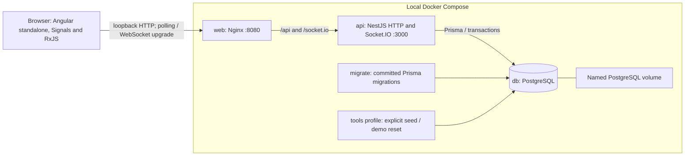

# Architecture

The app is a local, single-instance modular monolith: Angular in the browser,
NestJS with Express/Socket.IO in one API process, and PostgreSQL through Prisma.
GitHub runs CI; no application is deployed. The [README](../README.md#quick-start)
is the Docker entry point; [demo setup](demo.md) is optional and isolated.

## Runtime and startup

Only `127.0.0.1:${WEB_PORT}` is published. API/database share an internal backend
network; web is also attached to the frontend network. PostgreSQL healthy →
successful one-shot migration → API readiness healthy → web healthy is the
startup gate. `migrate` exiting zero is expected. Existing API/web must be stopped
before applying a changed schema; the documented down/build/up flow preserves
the volume. A volume persists data but is not a backup.

[Compose](../compose.yaml) defines the ordinary installation; the
[demo override](../compose.demo.yaml) fixes its own database/role, volume and
initialization marker. Optional tools never run on ordinary app startup. Seed is
repeatable and preserves existing content; reset is a separate explicit operation
restricted to the marked demo. [Maintenance and failure handling](demo.md#reset-manually)
explain stopping writers and keeping the app stopped if reseeding fails.

## Module boundaries

| Owner | Responsibility | Implementation |
| --- | --- | --- |
| Angular core | Session restoration, HTTP identity client and socket lifecycle | [core](../apps/web/src/app/core) |
| Angular features | Auth forms, channel directory, conversation state, history and recovery | [features](../apps/web/src/app/features) |
| Shared contracts | Compile-time DTOs and selected runtime guards; no database models or secrets | [contracts](../packages/contracts/src) |
| API identity | Registration/password hashing, session/CSRF policy and revocation | [identity](../apps/api/src/identity) |
| API channels | Discovery, membership and canonical channel locking/authorization | [channels](../apps/api/src/channels) |
| API messaging | Persisted ordering/idempotency and authorized history/recovery | [messaging](../apps/api/src/messaging) |
| API realtime | Authenticate transport, coordinate channel operations, acknowledge/emit and close sockets | [realtime](../apps/api/src/realtime) |
| API infrastructure | Database lifecycle, quotas, safe diagnostics and bounded shutdown | [database](../apps/api/src/database), [security](../apps/api/src/security), [logging](../apps/api/src/logging), [shutdown](../apps/api/src/shutdown) |

Controllers/gateway validate inputs at their boundaries. Identity comes from the
session; client-supplied author IDs do not select an actor. Channel membership is
checked on HTTP reads, sends and subscriptions, using the canonical access
service. Nginx's configured peer is the API's explicitly trusted proxy; arbitrary
forwarded headers do not establish a client IP. [Security boundaries](security-boundaries.md)
and [traffic limits](traffic-limits.md) describe the precise scope.

## Data and message flow

The [schema](../apps/api/prisma/schema.prisma) has `User`, `Session`, `Channel`,
`Membership`, `Message` and `ReadCursor`. Membership is the user/channel pair; channel creation
adds its creator atomically. Messages reference channel/author, have a unique
author/client key and a unique per-channel sequence. Session rows contain token
digests, never raw tokens. Restrictive foreign keys prevent implicit cascading
data loss; committed migrations also enforce message content/sequence bounds.

Sending follows session → quota/input validation → local channel queue →
transactional channel lock and membership check → retry lookup → counter/insert
commit → authorized recipient check/emission → success ack. A duplicate returns
the original row without another broadcast. Post-commit failure can return an
error or lose a response despite persistence. A UI timeout is an uncertain result,
so a retry must keep the original key and exact content.

The visible chat merges canonical IDs across ack/event/history, retaining pending
state while its view lives. History reads latest-first in pages of 50 with a
channel-bound snapshot cursor. Recovery reads ascending through fixed `(C,H]`
pages; the committed upper boundary is captured under the channel lock. Events
do not advance C. Reconnect, focus and the visible-tab 15-second interval trigger
reconciliation. [ADR-001](decisions/001-bounded-message-recovery.md) explains the
commit boundary, and [message contracts](messages.md) define cursors and UI races.

## Guarantee and evidence matrix

| Claim | Executable evidence | Limit |
| --- | --- | --- |
| Valid sessions survive API/container recreation | [persistence E2E](../e2e/persistence.spec.ts) | The database volume and credentials must be retained; CSRF keys restart |
| Read progress advances monotonically for the authenticated member; only foreign messages count as unread | [read-cursor integration](../apps/api/test/integration/read-cursor.ts), [unread E2E](../e2e/unread.spec.ts), [contract](read-cursors.md) | Visible reached message within recovered HTTP boundary; sequence prefix rather than proof of attention |
| Logout/expiry close affected sockets | [socket sessions](../apps/api/test/integration/socket-session.ts), [browser revocation](../e2e/session-revocation.spec.ts) | Local notifications/timers; transmitted data cannot be recalled |
| Membership authorizes history, sends and subscription | [membership](../apps/api/test/integration/membership.ts), [subscriptions](../apps/api/test/integration/subscriptions.ts) | Channels are open to registered users; membership is not confidentiality |
| Retried keys resolve once in persistence or conflict | [concurrent idempotency](../apps/api/test/integration/message-idempotency.ts) | Key is scoped to author; authorization still applies; not exactly-once delivery |
| Sequence reflects per-channel transactional commits | [message writes](../apps/api/test/integration/messages.ts), [commit/rollback races](../apps/api/test/integration/message-sync-races.ts) | Supported write path and immutable messages; no cross-channel total order |
| Missing live delivery can be recovered from committed rows | [suppressed emission](../apps/api/test/integration/commit-emission.ts), [browser gap](../e2e/sync-gap.spec.ts) | Visible channel, valid membership/session and eventual connectivity; no wall-clock completion bound |
| Late ack and events converge with pending sends | [retry/late ack E2E](../e2e/message-retry.spec.ts), [initial-load races](../e2e/channel-races.spec.ts) | View-local state and bounded attempt listeners; reload can discard drafts |
| Shutdown does not confirm rolled-back work | [shutdown integration](../apps/api/test/integration/shutdown.ts), [browser shutdown](../e2e/shutdown.spec.ts) | Forced exit may lose response/event after commit; retry the key; see [shutdown budget](operations.md#bounded-shutdown) |
| Demo reset refuses an unmarked target and invalidates old sessions | [guard tests](../scripts/reset-demo.test.mjs), [demo E2E](../e2e/demo-maintenance.spec.ts) | Explicit maintenance deletes all demo content; seed is a separate step |

These tests are reproducible checks, not a claim of universal reliability or
formal verification. CI runs unit/contract/Docker checks, database integration in
both orders, and Chromium E2Es on disposable stacks. It never deploys or merges.
See [CI diagnostics](e2e-ci.md) and [local QA](qa.md) for existing coverage/limits.
The [clean-checkout walkthrough](installation-verification.md) records the local
Docker installation, empty database, seed and retained session verification.

## Decisions

Continue the established `docs/decisions` sequence; these records describe choices
already implemented, rather than proposing a new stack:

- [ADR-001: Fixed committed recovery boundary](decisions/001-bounded-message-recovery.md).
- [ADR-002: Socket.IO transport plus HTTP reads](decisions/002-socket-io-transport.md).
- [ADR-003: PostgreSQL-backed opaque cookie sessions](decisions/003-server-side-sessions.md).
- [ADR-004: Ordered idempotent persistence and delivery limits](decisions/004-message-guarantees.md).

## Operating limits

One API instance and the synchronous in-memory Socket.IO adapter are supported.
Queues/rooms, rate buckets, CSRF keys and revocation events are process-local.
PostgreSQL availability is required for authenticated work. Local bootstrap DB
credentials are not a least-privilege deployment configuration. HTTPS, distributed
state, backups and capacity measurement need separate work before remote hosting.

There is no outbox, durable offline queue, offline-first mode, exactly-once network
delivery, typing or presence in the current implementation.
Live events are best-effort and recovery does not prove a recipient read a message.
Browser evidence is Chromium, without a physical-device or exhaustive accessibility
audit. [Operations](operations.md) covers safe logs, readiness/liveness and shutdown.
