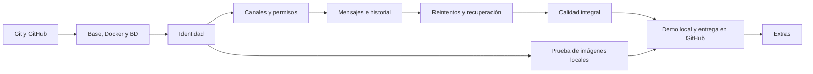

# Real-time Chat — Plan detallado de implementación

Revisión: 3 · Actualización: 2026-10-14 · Estado: tareas 0.0a–0.0c, 0.1a–0.1c, CP0-A, 0.2a–0.2d, CP0-D, 0.3a y CP0-B integrados; 0.3b, 1.1a, 1.1b y CP1-A integrados; 1.2a–1.2c y CP1-B integrados; 1.3a integrada mediante PR #20; 1.3b integrada mediante PR #21; 2.1a integrada mediante PR #22; 2.2a integrada mediante PR #23; 2.2b integrada mediante PR #24; CP2-A integrado mediante PR #25; 2.3a integrada mediante PR #26; 2.3b integrada mediante PR #27; CP2-B integrado mediante PR #28; 2.4a integrada mediante PR #29; 2.4b integrada mediante PR #30; CP2-C integrado mediante PR #31; 3.1a integrada mediante PR #32; 3.1b integrada mediante PR #33; CP3-A integrado mediante PR #34; 3.2a integrada mediante PR #35; 3.2b integrada mediante PR #36; CP3-B integrado mediante PR #37; 3.3a integrada mediante PR #38; 3.3b integrada mediante PR #39; 3.4a integrada mediante PR #40; CP3-C verificado, pendiente de revisión y merge manual. CP0-C y revisión de salida CP1-C pendientes.

## 1. Cómo usar este plan

Este archivo conserva el alcance del plan inicial y es la **única lista de tareas** del proyecto; no crear una segunda lista en `tasks/todo.md`. El razonamiento de producto está en [docs/ideas/real-time-chat.md](../docs/ideas/real-time-chat.md).

Se incorporan 0.0a–0.0c para comenzar por GitHub. Los identificadores originales 0.1–6.4 se conservan como prefijos: por ejemplo, 3.2 se divide en 3.2a y 3.2b. Las casillas indican implementación verificada; el registro distingue una PR pendiente de cambios integrados. Los agentes dejan las PR abiertas: solo el propietario revisa y ejecuta el merge.

Para cada sesión:
1. Elegir la primera tarea cuyas dependencias estén completas.
2. Leer el contrato y las pruebas de aceptación de esa tarea.
3. Implementar el cambio mínimo y sus pruebas de comportamiento.
4. Ejecutar la verificación indicada y revisar el diff.
5. Marcar la casilla solo si cumple la aceptación; registrar evidencia y siguiente tarea.
6. Si una tarea excede dos horas o unas cinco unidades de código mantenidas a mano, dividirla conservando el prefijo. No reducir criterios para hacerla caber.

Las rutas de archivos de tareas pendientes son propuestas. Actualizarlas al adoptar las convenciones reales del scaffold. Los checkpoints requieren revisar resultados antes de continuar; no implican pedir permiso entre tareas ya autorizadas. El despliegue remoto queda fuera del alcance actual.

## 2. Producto, prioridades y demostración

**Usuario funcional:** miembro de un equipo pequeño que conversa por canales.
**Público del portfolio:** evaluador técnico que necesita comprobar calidad y comprender decisiones.
**Propuesta:** un chat pequeño cuyo comportamiento sigue siendo coherente ante desconexiones y respuestas perdidas.

Recorrido objetivo de demo: abrir dos sesiones → entrar al mismo canal → enviar → desconectar una sesión → enviar desde la otra → reconectar → comprobar historial sin duplicados. Un vídeo y pruebas reproducibles mostrarán los fallos difíciles; no añadir un panel de desarrollo a la interfaz pública.

| Prioridad | Contenido | Condición |
|---|---|---|
| P0: v1 | Identidad, canales, membresía, mensajes, historial, confirmaciones, idempotencia, resincronización, seguridad, UI responsive, pruebas, CI y presentación | Obligatorio |
| P1 | Cursor de lectura y no leídos por canal | Después de completar P0 |
| P2 | Escritura y presencia | Después de P1, si aportan valor |
| P3 | Benchmark reproducible | Opcional; no anunciar capacidad no medida |

Excluido: privados, organizaciones múltiples, roles administrativos, adjuntos, audio/vídeo, edición/borrado, hilos, reacciones, búsqueda avanzada, email transaccional, push, E2EE, cola offline duradera, outbox, microservicios, Redis y varias instancias.

Los canales son **abiertos para usuarios registrados**: cualquiera puede unirse y acceder al historial anterior. Membresía no equivale a confidencialidad. Salir impide nuevas operaciones y recepciones futuras del servidor, pero no elimina información ya recibida.

## 3. Supuestos y esfuerzo

Se conserva el objetivo inicial de 4–6 jornadas como referencia agresiva. El desglose revela más trabajo que el primer cálculo: **53–74 horas concentradas para P0, más 20 % de contingencia (64–89 h, redondeadas)**, aproximadamente 8–12 jornadas de ocho horas. Incluye GitHub y ejecución completa en contenedores. Es una estimación preliminar, no un resultado medido. Recalibrar después de identidad y de la primera conversación completa.

| Etapa | Esfuerzo P0 estimado | Resultado demostrable |
|---|---:|---|
| 0. GitHub y base | 8–11 h | Repositorio remoto, aplicación en Compose y CI |
| 1. Identidad | 7–10 h | Usuario autenticado y sockets en contenedores locales |
| 2. Conversación | 10–13 h | Dos usuarios conversan con historial |
| 3. Fiabilidad | 13–18 h | Respuesta perdida y reconexión correctas |
| 4. Calidad integral | 9–13 h | Seguridad, UX y suite crítica verificadas |
| 5. Entrega local | 6–9 h | Demo Docker y documentación reproducibles en GitHub |
| Total base | 53–74 h | V1 local completa |
| 6. Extras | Estimar cada extra después de P0 | No incluidos en el total |

Decisión confirmada por el usuario: completar el alcance aunque requiera más tiempo. La dedicación diaria real sigue pendiente; afecta al calendario, no a los criterios de entrega. Si posteriormente se acuerda una fecha de entrega, conservar los criterios P0 y registrar con claridad cualquier trabajo pendiente.

**Recalibración CP2-C (2026-10-12):** las etapas 0–2 están implementadas, con CP0-C y CP1-C todavía pendientes. Quedan **36–53 h concentradas para P0**: 28–40 h de etapas 3–5, 2–4 h para los gates anteriores y 20 % de contingencia. Equivale aproximadamente a 18–27 jornadas de 2 h, 9–14 de 4 h o 5–7 de 8 h, más esperas de revisión. Git registra actividad del 7 al 12 de octubre y unas 33 h naturales entre los merges inicial/final de etapa 2; no son horas trabajadas y no permiten medir velocidad. La cifra restante sigue siendo provisional, sin fecha comprometida ni extras de etapa 6. Registrar esfuerzo real de las próximas sesiones y recalibrar en CP3-C. [Evidencia y supuestos](../docs/checkpoints/cp2-c.md#schedule-recalibration).

**Recalibración CP3-C (2026-10-14):** etapas 0–3 implementadas hasta 3.4a integrada mediante PR #40; CP3-C verificado, pendiente de revisión y merge manual. CP0-C y CP1-C siguen pendientes. Quedan **21–32 h concentradas para P0**: etapas 4–5 (15–22 h) y gates anteriores (2–4 h) suman 17–26 h; con 20 % de contingencia son 20,4–31,2 h, redondeadas hacia arriba. Equivale aproximadamente a 11–16 jornadas de 2 h, 6–8 de 4 h o 3–4 de 8 h, más esperas de revisión. Son los supuestos anteriores, sin timesheet ni velocidad medida; el tiempo entre merges no se cuenta como trabajo. No se reduce alcance ni se compromete fecha; extras de etapa 6 excluidos. Registrar esfuerzo real para la próxima recalibración. [Evidencia y límites](../docs/checkpoints/cp3-c.md#schedule-recalibration).

Decisión del usuario: **la aplicación se ejecutará solo en local por ahora**. GitHub alojará el código y ejecutará CI, pero no alojará la aplicación. No elegir proveedor, contratar hosting, configurar dominios, publicar imágenes en un registry ni preparar CD en esta entrega. La portabilidad futura se consigue con imágenes, configuración por entorno, migraciones y documentación.

## 4. Arquitectura y límites

Angular standalone, Signals para estado derivado de UI y RxJS para flujos asíncronos. Node.js/NestJS con Socket.IO. PostgreSQL/Prisma para persistencia y migraciones. Workspaces npm; monolito modular y una sola instancia de API. Versiones estables compatibles y lockfile se fijan en 0.1a, sin inventar versiones en este documento.

| Módulo | Posee | Consume |
|---|---|---|
| identity | Usuarios, hash de contraseña, sesiones y revocación | Base de datos |
| channels | Canales, membresías y política de acceso | identity |
| messaging | Mensajes, orden, idempotencia e historial | channels |
| activity, opcional | Cursor leído, escritura y presencia | messaging |

Los controladores y gateways son adaptadores delgados. Las reglas viven en servicios del dominio correspondiente; evitar duplicarlas entre HTTP y socket. No introducir repositorios genéricos, bus de eventos genérico, CQRS ni una capa por cada carpeta.

Un servicio de infraestructura puede indexar sockets por sesión/usuario y retirar suscripciones. Identidad emite una notificación de revocación local sin importar messaging: mantener dependencias de dominio en una sola dirección.

Estructura prevista:
```text
apps/web/src/app/
  core/                  # sesión y conexión
  features/auth/
  features/channels/
  features/chat/
apps/api/
  prisma/                # esquema, migraciones y seed
  src/identity/
  src/channels/
  src/messaging/
  src/realtime/          # gateway e índice local de conexiones
  src/health/
  test/
packages/contracts/src/  # DTO públicos, errores y validación compartida
e2e/                     # recorridos Playwright
docs/ideas/
docs/adr/
tasks/plan.md
```

Frontend y API se sirven bajo el mismo origen local, también mediante proxy en desarrollo. PostgreSQL conserva el estado durable; rooms y conexiones son efímeras. Socket.IO no es compatible directamente con cualquier cliente WebSocket nativo.

### Ejecución local obligatoria y portabilidad

Docker Engine/Docker Desktop con Compose v2 y Git serán suficientes para ejecutar la demo; no exigir Node ni PostgreSQL instalados en el host. Node local será opcional para quien prefiera desarrollar fuera de contenedores. Documentar soporte de Windows/Docker Desktop y permisos de volúmenes sin depender de scripts Bash.

| Servicio | Responsabilidad | Exposición |
|---|---|---|
| web | Servir Angular compilado y hacer proxy de /api y /socket.io hacia api | Solo 127.0.0.1:8080 por defecto |
| api | Node/NestJS, HTTP y Socket.IO | Red interna de Compose |
| db | PostgreSQL y volumen persistente | Red interna de Compose |
| migrate | Tarea de una ejecución que aplica migraciones versionadas | Sin puerto; termina antes de iniciar API |
| seed | Herramienta explícita para datos ficticios, perfil tools | Sin puerto; no se ejecuta en cada arranque |
| test | Herramientas de pruebas en entorno aislado, perfil test | Sin datos ni volúmenes de la demo |

Imágenes de web y API con etapas de build/runtime; objetivo tools para migraciones/seed y objetivos de desarrollo/test cuando hagan falta. Mantener dependencias de compilación fuera del runtime y no copiar .env, credenciales ni node_modules del host. Ejecutar procesos sin privilegios donde corresponda y no incluir secretos en argumentos de build.

Secuencia de arranque: BD saludable → migrate termina con éxito → API lista → web. Un contenedor arrancado no equivale a un servicio listo. Un fallo de migración bloquea API y deja un diagnóstico visible.

Compose normal sirve builds compilados sin bind mounts del código. Un override de desarrollo habilita recarga y volúmenes de código; dependencias Linux permanecen dentro de contenedores. No añadir Kubernetes, Terraform ni herramientas de despliegue sin necesidad.

Persistencia: docker compose down conserva el volumen de BD. Un reset destructivo es un comando separado, solo para datos de demo y con destino explícito. Probar arranque desde un volumen nuevo y reinicio sobre uno existente.

HTTP en localhost: cookie HttpOnly y SameSite con Secure desactivado únicamente en configuración local explícita. La configuración preparada para HTTPS futuro exige Secure. API y Socket.IO usan rutas relativas; no compilar un dominio o proveedor dentro del frontend.

Despliegue futuro, fuera de P0: documentar cambios necesarios (origen/HTTPS, secretos, BD y backups, proxy y migraciones) sin ejecutarlos. No se afirma que un proveedor remoto esté validado por funcionar en Docker local.

## 5. Modelo de datos mínimo

Crear cada tabla cuando su recorrido la necesite, no todo el esquema de antemano.

| Entidad | Campos esenciales | Restricciones / índices |
|---|---|---|
| User | id UUID, emailNormalizado, displayName, passwordHash, createdAt | Email único; no devolver hash ni email en mensajes |
| Session | id, userId, tokenHash, expiresAt, createdAt | tokenHash único; índice por userId y expiresAt |
| Channel | id UUID, slug, name, createdBy, lastSequence, createdAt | slug único; lastSequence comienza en 0 |
| Membership | userId, channelId, joinedAt | Clave compuesta; índice por channelId para miembros |
| Message | id UUID, channelId, authorId, clientMessageId, sequence, body, createdAt | Únicos (authorId, clientMessageId) y (channelId, sequence) |
| ReadCursor, P1 | userId, channelId, lastReadSequence | Clave compuesta; avance monotónico |

Las relaciones usan claves foráneas. No hay borrado de usuarios/canales/mensajes en P0. Secuencias BIGINT se serializan como cadenas decimales en JSON y se comparan numéricamente, nunca lexicográficamente ni convirtiendo ciegamente a Number.

El índice compuesto de mensajes sirve a las consultas por canal y secuencia; justificar índices adicionales mediante consultas reales. Migraciones versionadas, seed idempotente y ninguna sincronización destructiva de esquema en producción.

## 6. Contratos de comportamiento

### 6.1 Identidad y permisos

Sesión opaca aleatoria, solo su hash en BD; cookie HttpOnly, Secure en producción y SameSite=Lax. Duración absoluta inicial: 24 h, configurable. Logout revoca **la sesión actual**, incluidas sus conexiones; otras sesiones del usuario siguen funcionando. Sin refresh tokens ni recuperación de contraseña en P0.

Validar origen y proteger mutaciones HTTP con token CSRF vinculado a sesión; bootstrap de token preautenticado para registro/login. Validar origen también en el handshake y en todos los transportes habilitados. El handshake comprueba sesión, pero no sustituye autorización por operación.

Caducidad: temporizador por sesión conectada y nueva validación antes de operaciones; al revocar, desconectar sockets de esa sesión. Una conexión inactiva tampoco puede continuar recibiendo indefinidamente. Un evento ya enviado por red no puede retirarse.

Unirse crea Membership; suscribirse a eventos solo observa un canal del que ya se es miembro. Mantener separados esos conceptos. La v1 observa el canal seleccionado; el cambio de canal cancela peticiones obsoletas y cambia la suscripción.

### 6.2 HTTP propuesto

Rutas bajo `/api`. Cerrar cada contrato al implementar su recorrido; no diseñar todavía los endpoints de los extras.

| Método y ruta | Entrada / salida relevante | Permiso |
|---|---|---|
| GET /auth/csrf | Token para formulario preauth o sesión | Origen permitido |
| POST /auth/register | email, password, displayName → usuario público; continuar a login | Preauth y CSRF |
| POST /auth/login | Credenciales → cookie y usuario | Preauth y CSRF |
| GET /auth/me | Usuario actual | Sesión |
| POST /auth/logout | Revoca sesión; limpia cookie | Sesión y CSRF |
| GET /channels | Página de canales con isMember | Sesión |
| POST /channels | name, slug → canal y membresía del creador | Sesión y CSRF |
| PUT /channels/:id/membership | Unión idempotente | Sesión y CSRF |
| DELETE /channels/:id/membership | Salida idempotente y retirada de suscripciones | Sesión y CSRF |
| GET /channels/:id/messages | before opcional, limit → items ASC, olderCursor, snapshotCursor | Miembro |
| GET /channels/:id/messages/sync | after, until opcional, limit → items ASC, nextCursor, until, hasMore | Miembro |
| GET /health/live | Proceso vivo | Público, sin detalles internos |
| GET /health/ready | Capacidad de atender con BD | Público, respuesta mínima |

`before` y `after` son excluyentes por diseño de rutas. Cursores versionados con canal y secuencia, validados; cursor opaco no equivale a autorización ni necesita contener secretos. Un cursor de otro canal se rechaza.

Error común: `{ code, message, requestId, fieldErrors? }`. Códigos: VALIDATION_ERROR, UNAUTHENTICATED, FORBIDDEN, NOT_FOUND, CONFLICT, RATE_LIMITED, INTERNAL_ERROR. Mapear HTTP a 400/401/403/404/409/429/500; no enviar stack traces. El cliente decide por code, no por texto.

### 6.3 Socket.IO propuesto

| Dirección | Evento | Datos / resultado |
|---|---|---|
| Cliente → servidor | channel:subscribe | channelId; ack tras comprobar sesión y membresía |
| Cliente → servidor | channel:unsubscribe | channelId; idempotente |
| Cliente → servidor | message:send | channelId, clientMessageId UUID, body; ack con mensaje persistido |
| Servidor → cliente | message:created | Mensaje canónico con id, sequence, autor público y fecha |
| Servidor → cliente | channel:access-revoked | channelId; limpiar vista y cursor local de ese canal |
| Servidor → cliente | session:revoked | Motivo seguro; después desconectar |
| Ambos | Eventos de conexión propios de Socket.IO | Conectado, desconectado, reconectando |

Ack: `{ ok: true, data }` o `{ ok: false, error }`. Autor y sesión proceden del servidor. Ambos caminos, ack y message:created, pueden llegar en cualquier orden; el reducer debe reconciliarlos.

P0 no depende de connection-state recovery nativa de Socket.IO. La recuperación propia funciona también después de reiniciar la API. No añadir una segunda estrategia de recuperación hasta medir la necesidad.

### 6.4 Persistencia, idempotencia y orden

1. Validar sesión, payload y límites.
2. Abrir transacción; bloquear la fila del canal y verificar membresía actual.
3. Buscar la clave (autor, clientMessageId). Si existe y coincide canal/contenido, devolver el mismo mensaje; si difiere, CONFLICT. Volver a autorizar también los reintentos.
4. Para un mensaje nuevo, incrementar lastSequence e insertar dentro de la misma transacción.
5. Confirmar transacción. Solo entonces emitir y responder.
6. Ante colisión concurrente de clave única, resolver fuera de la transacción abortada, con una lectura autorizada del registro existente. No convertir cualquier error de BD en éxito.

El contador y los envíos del mismo canal se serializan. Una secuencia global o una fecha no bastan para representar el orden de commit. No realizar llamadas de red ni hashes de contraseñas mientras se mantiene el bloqueo.

Unión/salida y envío usan un orden consistente de bloqueos del canal. Si el envío se autoriza antes de la salida puede completarse; si la salida se confirma primero, se rechaza. La retirada de rooms debe completarse antes del ack de salida. Coordinar suscripción/salida y emisión en la instancia para que una suscripción en carrera no quede autorizada después; documentar el punto de orden y probar ambos órdenes. No construir un motor de permisos genérico.

No se promete entrega exactamente una vez. Se ofrece persistencia deduplicada y convergencia del cliente tras reconciliar, mientras el usuario siga autorizado.

### 6.5 Recuperación sin huecos

Separar **olderCursor** (pasado no cargado) y **syncCursor C** (novedades recuperadas de manera completa). Un evento vivo puede actualizar la lista, pero nunca avanzar C por sí solo.

Carga inicial: suscribirse, solicitar la cola reciente con un límite superior confirmado H y mezclar eventos por ID. La consulta incluye solo mensajes con secuencia ≤ H. Al completar la respuesta, fijar C=H; mensajes anteriores no cargados se solicitan por olderCursor.

Recuperación: capturar H al iniciar y paginar el intervalo (C,H]. Todas las páginas mantienen H. Avanzar C únicamente después de incorporar la página completa; cuando termina, C=H. Eventos > H se mezclan visualmente y serán confirmados por la siguiente recuperación. Así la recuperación termina aunque siga llegando tráfico.

Disparadores: reconexión, entrada al canal, recuperación del foco y cada 15 s mientras el canal esté visible y conectado. Una recuperación activa por canal; cancelar al salir y descartar respuestas de una selección anterior. Revalidar membresía en cada página.

Reconciliación periódica cubre commit sin emisión incluso sin desconexión detectable. El intervalo es configurable, no una garantía de latencia bajo fallos. Si hay cursor inválido o nueva generación de datos demo, descartar estado del canal y cargar una instantánea nueva.

### 6.6 Estados y UX

- Envío: **pendiente → confirmado**, **pendiente → sin confirmar** por timeout y **pendiente → rechazado** ante error definitivo.
- Timeout no prueba que el mensaje se haya perdido. Reintentar conserva clientMessageId y body; editar tras rechazo crea un envío nuevo.
- Ack tardío o evento del mismo mensaje sustituye al pendiente, sin duplicar. No reintentar automáticamente errores de validación/autorización.
- Conexión: conectando, conectado, reconectando, desconectado y sesión expirada. Desactivar envío nuevo sin conexión; conservar borrador en memoria.
- Historial: carga inicial, vacío, listo, cargando anteriores y error recuperable. Mantener el scroll al anteponer mensajes.
- No saltar al final si el usuario lee mensajes anteriores; mostrar acción para ver nuevos mensajes.
- Enter envía, Shift+Enter inserta línea; respetar composición de teclado/IME. Formularios etiquetados, foco visible y avisos accesibles sin anunciar de golpe todo el historial.
- Una lista de mensajes por canal visible, paginada. Si aparecen problemas de rendimiento, medir antes de añadir virtualización.

### 6.7 Valores iniciales para validar

Son decisiones del proyecto, configurables y revisables con evidencia, no capacidades garantizadas por las bibliotecas.

| Parámetro | Valor inicial |
|---|---|
| Texto | 1–2.000 puntos de código Unicode; rechazar texto solo en blanco |
| Frame/payload socket | Máximo 16 KiB |
| Página de historial/canales | 50 por defecto, máximo 100 |
| Confirmación | Deadline UI 5 s; un reintento automático con la misma clave si hay conexión, luego acción manual. Ack tardío aceptado hasta 30 s por intento; errores explícitos no disparan retry automático |
| Reconciliación | 15 s en canal visible/conectado; reintentos de consulta con backoff acotado |
| Sesión | 24 h absolutas; configurable para pruebas |
| Envíos | 30 por 10 s por usuario, sumando sus sockets |
| Login | 10 intentos por minuto por IP; ajuste para entorno demo |
| Registro / creación de canales | 5 por hora por IP / 10 por hora por usuario |
| Conexiones | 5 simultáneas por sesión; política de error documentada |

Usar reloj controlado para pruebas de límites. Configurar confianza en proxy explícitamente antes de usar IP reenviada. Límites en memoria son aceptables para una instancia y se reinician con el proceso; dejar esa limitación documentada.

## 7. Herramientas, pruebas y definición de terminado

Comandos objetivo, **todavía no implementados**. Desde el repositorio clonado, copiar .env.example a .env y ajustar únicamente valores locales; documentar la copia equivalente en PowerShell y shells Unix.

Ruta principal, sin Node ni PostgreSQL en el host:
```text
docker compose config --quiet
docker compose up --build -d --wait
docker compose --profile tools run --rm seed
docker compose ps
docker compose logs --tail=100 api
docker compose restart api
docker compose down
```

La tarea migrate forma parte del arranque y debe terminar correctamente antes de api. Seed se añade en 5.1a; hasta entonces crear usuarios mediante registro. Entrada local prevista: http://localhost:8080. down no lleva -v.

Verificación en contenedores, al implementar los servicios de test:
```text
docker compose -f compose.test.yaml --profile test run --rm test
```
El archivo de pruebas usa nombre de proyecto/volumen aislado y ejecuta lint, tipos, pruebas y build con estado de salida no cero ante cualquier fallo. CI utiliza ese entorno o comandos equivalentes y además comprueba las imágenes/runtime de Compose.

Ruta opcional de desarrollo con Node local:
```text
npm ci
npm run dev
npm run lint
npm run typecheck
npm test
npm run test:integration
npm run test:e2e
npm run build
```
La ruta containerizada de desarrollo usa compose.yaml más compose.dev.yaml; detallar el comando final al crear el override.

Crear scripts de pruebas cuando exista la primera prueba de ese nivel; no usar flags que simulen éxito si faltan pruebas. Definir comandos de migración local y despliegue por separado durante 0.2b, para no ejecutar migraciones de desarrollo sobre producción.

Unitarias: reducer, transiciones de estado y cursores. Integración: servicios/API/gateway con PostgreSQL y clientes Socket.IO reales. E2E: Playwright con contextos aislados. Elegir runners compatibles con los scaffolds; no forzar uno distinto solo por uniformidad.

Pruebas de fallos mediante dependencias sustituibles o hooks exclusivos del entorno de test; nunca endpoints públicos que permitan provocar caídas. Usar barreras/promesas para coordinar carreras, no sleeps arbitrarios.

Una tarea termina cuando cumple aceptación, pasa su verificación, maneja errores relevantes, no filtra secretos y registra evidencia. Un checkpoint incluye build y revisión de las pruebas afectadas; ejecutar toda la suite en los cierres de etapa que lo indiquen. No imponer una cifra de cobertura sin relación con riesgos.

## 8. Etapas y tareas

S = cambio pequeño; M = sesión de hasta dos horas como objetivo. Los archivos enumerados son las principales unidades de trabajo manual; el scaffold genera archivos adicionales que se revisan en su tarea. Si el trabajo real crece, dividirlo antes de continuar.

### Etapa 0 — GitHub y base reproducible

**Objetivo:** configurar primero GitHub, después arrancar web, API y BD en contenedores y verificar la base en CI.

- [x] **0.0a — Preparar el repositorio Git local** · S · Depende de: ninguna.
  - Trabajo: inspeccionar Git existente, conservar cambios/historial y estos documentos; inicializar solo si no existe repositorio. Preparar main, ignores y un README inicial. Comprobar identidad Git sin alterar configuración global.
  - Aceptación: archivos de planificación conservados; .env, credenciales, dependencias y salidas de build excluidos; primer commit revisado.
  - Verificar: git status, git diff --cached y git log; comprobar que no se añade material sensible.
  - Archivos: .gitignore, README.md y documentos actuales; metadatos Git locales.
- [x] **0.0b — Crear o vincular el repositorio en GitHub** · S · Depende de: 0.0a.
  - Trabajo: comprobar cuenta autenticada y repositorio existente; usar real-time-chat como nombre propuesto, resolver propietario y visibilidad antes de crearlo. Reutilizar el remoto correcto si existe; no sobrescribir historial remoto.
  - Aceptación: origin apunta al repositorio acordado, main está sincronizada y contiene el plan; GitHub no ejecuta ni despliega la aplicación.
  - Verificar: remoto, rama por defecto, archivos en GitHub y clonación a un directorio temporal limpio.
  - Archivos: README.md con enlace del repositorio; configuración remota Git/GitHub.
- [x] **0.0c — Definir el flujo de trabajo de GitHub** · S · Depende de: 0.0b.
  - Trabajo: descripción/topics, plantilla breve de PR y convención de ramas/commits. Mantener tareas en este archivo; no duplicarlas en Projects o Issues. Añadir protección de main y checks cuando CI exista y la cuenta lo permita, sin exigir aprobador externo en un proyecto individual.
  - Aceptación: cambios pequeños revisables; se documenta cómo integrar una etapa y registrar evidencia. No crear workflows de despliegue ni credenciales de hosting.
  - Verificar: revisar ajustes y plantilla; distinguir reglas aplicadas de recomendaciones todavía pendientes.
  - Archivos: .github/pull_request_template.md, CONTRIBUTING.md, README.md.

**Checkpoint CP0-G:** repositorio de GitHub creado o vinculado y plan versionado; el trabajo de aplicación empieza a continuación.

- [x] **0.1a — Fijar runtime y workspace** · S · Depende de: 0.0c.
  - Trabajo: elegir versiones compatibles, scripts comunes y gestor npm; documentar requisitos locales.
  - Aceptación: instalación reproducible con lockfile; configuración estricta y sin secretos.
  - Verificar: instalación limpia y lectura de versiones reales.
  - Archivos: `package.json`, `package-lock.json`, `.node-version`, `.npmrc`, `tsconfig.base.json`, `README.md`; `.gitignore` ya cubre node_modules. Configuración pequeña repartida por responsabilidad, sin scaffolds ni paquetes vacíos.
- [x] **0.1b — Arrancar la API** · M · Depende de: 0.1a. Integrada mediante PR #2 por el propietario.
  - Trabajo: scaffold NestJS mínimo, validación de configuración y endpoint live.
  - Aceptación: responde 200 y rechaza configuración obligatoria ausente con error comprensible.
  - Verificar: build API y prueba HTTP de live.
  - Archivos: `apps/api/package.json`, `src/main.ts`, `src/app.module.ts`, `src/health/live.controller.ts`, `test/health.spec.ts` dentro de apps/api salvo indicación.
  - Evidencia: NestJS 12.1.2; GET /api/health/live → 200 con status=ok; NODE_ENV/PORT obligatorios y HOST validado; npm ci, 15 pruebas con node:test, build y typecheck correctos. Arranque con npm start y .env comprobado; sin BD ni Docker todavía.
- [x] **0.1c — Arrancar la web** · M · Depende de: 0.1a, 0.1b. Integrada mediante PR #3 por el propietario.
  - Trabajo: scaffold Angular, shell con navegación mínima y proxy de desarrollo a API.
  - Aceptación: pantalla inicial consume live bajo el mismo origen; estados de carga/error visibles.
  - Verificar: build web y navegador con API disponible y detenida.
  - Archivos: `apps/web/package.json`, `angular.json`, `proxy.conf.json`, `src/app/app.ts`, `src/app/app.html` dentro de apps/web.
  - Evidencia: Angular 22.2.1 con CLI/build 22.2.2; proxy /api/**; carga, error, reintento y timeout de 5 s; 3 pruebas web y 15 API; build y typecheck de ambos workspaces. Chrome confirma error con API detenida y recuperación al arrancarla; sin desbordamiento a 320/768/1024/1440 px; enlace de salto mueve el foco a main. Commits incrementales publicados para revisión.

**Checkpoint CP0-A:** web y API arrancan por los comandos documentados; revisar scaffolds y eliminar ejemplos innecesarios.

Resultado (2026-10-08): **superado** sobre main `e6664d6`.
- `npm run toolchain:versions`: Node 24.21.0, npm 12.1.0, TypeScript 6.0.3.
- `npm run build`, `npm run typecheck` y `npm test`: correctos; 15 pruebas API y 3 web.
- Comprobación de las pruebas: invertir temporalmente la condición de status provocó dos fallos esperados; código original restaurado sin cambios de aplicación.
- `npm start` y `npm run start:web`: arranque correcto con la configuración local; live devuelve 200 y `{"status":"ok"}` tanto en el puerto 3000 como mediante el proxy del 4200.
- Chrome muestra API disponible; al detener la API y repetir la comprobación muestra error y permite reintentar. Servidores de comprobación detenidos al finalizar.
- Revisión de scaffolds: sin Hello World, páginas de ejemplo, servicios vacíos ni artefactos generados versionados. Los archivos actuales soportan arranque, configuración, interfaz o pruebas; no hace falta eliminar código.
- Docker y proxy de producción siguen en 0.2c; lint y CI en 0.3b. No bloquean este checkpoint de arranque local.

- [x] **0.2a — Levantar PostgreSQL local** · S · Depende de: 0.1a. Integrada mediante PR #5 por el propietario.
  - Trabajo: Compose con volumen, health check y configuración ejemplo.
  - Aceptación: BD disponible, credenciales fuera del repositorio y reinicio sin perder datos.
  - Verificar: arranque, conexión y reinicio con un registro de prueba.
  - Archivos: `compose.yaml`, `.env.example`, `README.md`.
  - Evidencia: PostgreSQL 18.6-bookworm; health check healthy; conexión de red autenticada y rechazo de contraseña incorrecta; Compose rechaza contraseña vacía. Volumen real-time-chat_postgres_data conserva un registro tras down/up; tabla de prueba eliminada. Puerto solo 127.0.0.1:5432; credenciales generadas en .env ignorado. Base detenida conservando volumen al finalizar. Integración Prisma pendiente de 0.2b.
- [x] **0.2b — Integrar Prisma y la primera migración** · M · Depende de: 0.1b, 0.2a. Integrada mediante PR #6 por el propietario.
  - Trabajo: User y Session, servicio de BD, scripts de migración para local/despliegue y conexión de tests.
  - Aceptación: migración reproducible sobre BD vacía; conexión cerrada al finalizar tests.
  - Verificar: migrar y probar restricciones de email/tokenHash con PostgreSQL real.
  - Archivos: `apps/api/prisma/schema.prisma`, migración generada, `src/database/database.service.ts`, `test/database.spec.ts`, `apps/api/package.json`.
  - Evidencia: Prisma 7.10.0, cliente ESM generado e ignorado; migración User/Session aplicada a BD vacía y repetida sin pendientes. Nest comprueba conexión al arrancar y libera pool al cerrar; DATABASE_URL validada sin exponer credenciales. 16 pruebas API, 3 web y 6 resultados de integración en BD separada real_time_chat_test (unicidad email/tokenHash, FK, rollback, cierre, fallo de conexión). npm ci, build y typecheck correctos; audit sin vulnerabilidades con overrides documentados del CLI. Pruebas en test/integration/database.spec.ts; datos de prueba eliminados y procesos detenidos.
- [x] **0.2c — Ejecutar toda la aplicación con Compose** · M · Depende de: 0.1c, 0.2b. Integrada mediante PR #7 por el propietario.
  - Trabajo: Dockerfiles web/API y Compose con red interna, volumen, proxy y tarea migrate; exponer solo web en loopback.
  - Aceptación: desde clon limpio, up --build --wait sirve la pantalla y conecta con BD sin Node/PostgreSQL en el host; un error de migración impide iniciar API.
  - Verificar: config --quiet, arranque desde volumen nuevo, logs/health, down y nuevo up conservando datos.
  - Archivos: apps/web/Dockerfile, apps/api/Dockerfile, compose.yaml, docker/nginx.conf, .dockerignore.
  - Evidencia: imágenes multi-stage construidas con 16 pruebas API y 3 web en Linux; 2 pruebas de URL/credenciales. Stack healthy y live HTTP 200 en navegador mediante Nginx; solo web publicado en loopback, API/web no root. Clon local limpio sin dependencias del host y volumen nuevo verificados; migración exitosa antes de API; fallo controlado exit 17 bloquea API/web. Registro conserva datos tras down/up. Runtime sin Prisma CLI/TypeScript; motor de migración incluido al construir la imagen. Override compose.host.yaml explícito verificado con 6 resultados de integración. Stack detenido, volumen principal conservado y volumen de prueba eliminado.
- [x] **0.2d — Preparar desarrollo en contenedores** · M · Depende de: 0.2c. Integrada mediante PR #8 por el propietario.
  - Trabajo: override de desarrollo con recarga de web/API y dependencias internas; instrucciones Windows y Unix.
  - Aceptación: editar código actualiza el servicio sin reconstruir todo; node_modules del host no pisa dependencias Linux.
  - Verificar: modificar un texto y un handler temporalmente, comprobar recarga y restaurar; comprobar paridad con build normal.
  - Archivos: compose.dev.yaml, Dockerfiles web/API, README.md.
  - Evidencia: Compose Watch 5.5.1 en Windows sincroniza texto Angular sin refrescar el navegador y reinicia/recompila API al editar su handler. Respuesta temporal HTTP confirmada; ambos cambios restaurados y recargados. Identificadores de imágenes iguales antes/después; API/web con usuario node y sin mounts del host. Typecheck de ambos servicios correcto dentro de Docker. Dependencias/configuración/esquema requieren down y up --build --watch explícitos; comandos compatibles con PowerShell y Unix documentados.

**Checkpoint CP0-D:** demo base y desarrollo funcionan en Docker; el host no necesita instalar herramientas del stack.

Resultado (2026-10-09): **superado con corrección de caché** sobre main `c7ff6b4` y el cambio Nginx integrado por el propietario mediante PR #9.
- Clon limpio en `.git/cp0d-checkout`, sin node_modules, dist ni cliente Prisma generado en el host. Solo Git, PowerShell y Docker para construir/arrancar; Docker Engine 29.8.0 y Compose 5.5.1 en Windows con contenedores Linux. No se desinstalaron las herramientas existentes del host; el flujo no las invocó.
- Proyecto aislado `cp0d-verification`, puerto web `127.0.0.1:18080`, credenciales temporales y volumen nuevo. `docker compose -p cp0d-verification up --build --wait`: correcto; 16 pruebas API y 3 web dentro de las imágenes, migración inicial exitosa, API/web/BD healthy. Chrome muestra API disponible.
- Cambio al comando documentado `up --build --watch` con ambos archivos Compose: base conservada y migración sin pendientes. API/web no root y sin mounts; dependencias Linux internas. Solo web publicada.
- Edición temporal del handler: respuesta HTTP con marcador CP0-D. Edición/restauración de texto: actualización automática de Angular comprobada. Imágenes sin cambios durante la sincronización.
- Error TypeScript intencional: compilación falla con TS2322 y API sale con código 1. Restaurar el archivo permite a Watch reiniciar y recuperar `{"status":"ok"}` sin reconstruir imagen ni intervención manual en el contenedor.
- Hallazgo corregido: los bundles de nombre estable podían quedar en caché al cambiar de modo. Nginx añade `Cache-Control: no-cache` en archivos web; `nginx -t` y comprobaciones HTTP de `/` y `/main.js` correctos. README documenta recarga forzada para cachés anteriores a la corrección.
- Regresión comprobada: después de cargar el build Nginx corregido, volver a desarrollo en el mismo origen/pestaña permite recibir otro cambio de texto automáticamente. Fuentes temporales restauradas; contenedores/redes/volumen del proyecto de prueba eliminados tras comprobar su etiqueta de propietario; `.env` temporal eliminado. Volumen principal `real-time-chat_postgres_data` conservado.
- No se amplía el alcance: CI/lint siguen en 0.3b; contrato de errores en 0.3a. Validación realizada en Windows; no se afirma una ejecución en host Unix ni despliegue remoto.

- [x] **0.3a — Establecer contrato de error** · S · Depende de: 0.1b, 0.1c. Integrada mediante PR #10 por el propietario.
  - Trabajo: paquete contracts, error público y mapeo HTTP; mantenerlo limitado al recorrido actual.
  - Aceptación: un error validado contiene code/requestId sin stack; web puede interpretarlo.
  - Verificar: prueba del error y build de consumidores.
  - Archivos: `packages/contracts/package.json`, `src/errors.ts` dentro del paquete, `apps/api/src/http/error.filter.ts`, `apps/api/test/errors.spec.ts`, configuración de alias.
  - Implementación: workspace privado con exports JS/declaraciones (sin alias de runtime), guard de contrato, filtro global Nest y consumo por code en Angular. Mensajes públicos fijos; UUID v4 generado por el servidor, igual en cuerpo/X-Request-Id; no-store. Códigos HTTP previstos mapeados; excepciones/status no mapeados normalizados a 500. Sin propagar mensajes de excepciones ni errores de campo hasta introducir formularios.
  - Evidencia: 17 pruebas API (incluyen nueve escenarios HTTP, 404 real y JSON inválido), 5 web y 2 de contrato correctas. Mutación temporal de requestId provocó fallo esperado; fuente restaurada. Build/typecheck de todos los workspaces correctos. Imágenes normales compiladas con pruebas Linux; stack healthy y 404 mediante Nginx con contrato/header coincidentes. Hooks y Dockerfiles construyen contracts antes de consumidores; cambios compartidos requieren rebuild documentado.
  - Verificación de desarrollo: Compose Watch arranca ambos consumidores no root con contracts compilado dentro de las imágenes. Handler temporal 429 devuelve RATE_LIMITED sin texto privado; Chrome muestra mensaje específico y recupera API disponible al restaurar/reintentar. Cambios temporales retirados; stack detenido conservando volumen.

**Checkpoint CP0-B:** BD nueva migrada, errores seguros y tipos compartidos compilables.

Resultado (2026-10-09): **superado** sobre main `07bc90c`, sin cambios de aplicación. Evidencia integrada por el propietario mediante PR #11.
- Proyecto Docker aislado `cp0b-verification`, volumen nuevo y puerto web `127.0.0.1:18081`. `up --build --wait` correcto usando caché de las imágenes verificadas en 0.3a; migración inicial aplicada y API/web/BD healthy.
- Segunda ejecución de `migrate deploy`: sin migraciones pendientes. Base separada `cp0b_test` creada vacía; suite de integración ejecutada dentro del target development no root, usando las credenciales temporales dentro del contenedor, sin publicar PostgreSQL.
- Seis resultados de integración correctos: migración, unicidad email/token, claves foráneas y restricción de borrado, rollback, liveness con wiring real, cierre del pool y error de conexión sin URL privada. Consulta final: cero usuarios, cero sesiones y una migración completada en la base de prueba.
- Prueba HTTP de errores y dos pruebas del guard compartido ejecutadas en Linux: tres resultados correctos; cubren códigos, JSON inválido, mensajes privados, requestId no confiable y cuerpos mal formados.
- Comprobación externa vía Nginx: `/api/missing?token=private-probe` con cabecera requestId falsa devuelve 404/NOT_FOUND, UUID generado por servidor coincidente en cuerpo/cabecera y ningún dato privado ni stack; live devuelve `{"status":"ok"}`.
- `npm run typecheck` correcto para API, Angular y contracts. Consumidores compilables en las imágenes; se reutiliza la evidencia de 17 pruebas API y 5 web del build integrado de 0.3a, sin presentarla como ejecución nueva.
- Recursos y credenciales temporales eliminados tras comprobar la etiqueta del volumen de prueba. Volumen principal `real-time-chat_postgres_data` conservado. Sin hallazgos bloqueantes; CI/lint quedan en 0.3b.

- [x] **0.3b — Añadir CI inicial** · M · Depende de: 0.0c, 0.2d, 0.3a. Integrada mediante PR #12.
  - Trabajo: lint, tipos, pruebas existentes y build; PostgreSQL efímero para integración y caches reproducibles.
  - Aceptación: errores detienen el pipeline; no exponer credenciales reales ni omitir fallos.
  - Verificar: comandos locales equivalentes y ejecución real de GitHub Actions sobre el remoto de 0.0b; comprobar build de imágenes sin publicarlas.
  - Archivos: `.github/workflows/ci.yml`, `package.json`, configuración lint, configuración de tests, `README.md`.
  - Evidencia: ESLint recomendado para TS/JS y templates Angular/accesibilidad, cero warnings y prueba negativa de variable sin usar rechazada. Instalación limpia local, lint/typecheck, 24 pruebas de aplicación/contrato, 2 Docker, build y audit correctos (cero vulnerabilidades).
  - CI real: [ejecución 37888566965](https://github.com/MatteoMurcia/real-time-chat/actions/runs/37888566965), ambos jobs correctos; Quality en 63 s con 6 resultados de integración PostgreSQL y Containers en 86 s con build/arranque/migración/health vía Nginx. Contraseñas efímeras generadas y enmascaradas, limpieza always, cache npm por lockfile, actions fijadas por SHA, token read-only y cancelación de ejecuciones sustituidas. Sin despliegue ni publicación de imágenes.
  - Protección verificada: main exige Quality y Containers de GitHub Actions (app 15368), strict=true. Conserva PR obligatoria también para admins, cero aprobaciones externas, historial lineal, conversaciones resueltas y bloqueo de force-push/borrado. Merge reservado al propietario.

**Salida CP0-C:** clon limpio arranca en Docker, CI pasa en GitHub y el plan está versionado. Configurar los checks de main definidos en 0.0c según disponibilidad.

### Etapa 1 — Identidad y validación en Docker local

**Objetivo:** un usuario completa registro/login/logout; el navegador restaura una sesión válida.

- [x] **1.1a — Registrar una cuenta en API** · M · Depende de: 0.2b, 0.3a. Integrada mediante PR #13.
  - Trabajo: normalización de email, validación de nombre/contraseña, hash Argon2id y CSRF preauth; contrato con errores.
  - Aceptación: cuenta persistida, duplicado controlado y ningún hash expuesto.
  - Verificar: integración válida, inválida, duplicada y petición sin protección CSRF.
  - Archivos: `packages/contracts/src/auth.ts`, `apps/api/src/identity/registration.service.ts`, `registration.controller.ts`, `csrf.service.ts`, `apps/api/test/registration.spec.ts`.
- [x] **1.1b — Completar registro desde Angular** · M · Depende de: 1.1a, 0.1c. Integrada mediante PR #14.
  - Trabajo: formulario accesible y cliente de identidad; tras éxito dirigir a login.
  - Aceptación: validaciones comprensibles, estado de envío y prevención de doble submit.
  - Verificar: navegador/primer E2E de registro, incluyendo error servidor.
  - Archivos: `apps/web/src/app/features/auth/register.ts`, `register.html`, `apps/web/src/app/core/auth-client.ts`, rutas web, `e2e/register.spec.ts`.

**Checkpoint CP1-A — VERIFICADO (2026-10-09):** cuenta creada desde navegador; PostgreSQL almacena hashes Argon2id y las respuestas solo exponen campos públicos. Evidencia detallada al final del documento; integrado mediante PR #15.

- [x] **1.2a — Crear y consultar sesiones** · M · Depende de: 1.1a. Integrada mediante PR #16.
  - Trabajo: login, cookie segura, hash de token, expiración absoluta y /me.
  - Aceptación: credenciales incorrectas dan error genérico; sesión válida se restaura y sesión caducada se rechaza.
  - Verificar: integración de cookie, token desconocido, expiración y CSRF en login.
  - Archivos: `apps/api/src/identity/session.service.ts`, `session.controller.ts`, `password.ts`, `apps/api/test/session.spec.ts`, integración de BD y contrato auth. `/me` valida directamente mediante el servicio; añadir guard al compartir protección entre más endpoints.
- [x] **1.2b — Integrar login y rutas protegidas** · M · Depende de: 1.2a, 1.1b. Integrada mediante PR #17.
  - Trabajo: pantalla login, estado de sesión y restauración antes de resolver rutas protegidas.
  - Aceptación: recarga mantiene sesión; 401 muestra acceso requerido y no crea bucles de redirección.
  - Verificar: E2E login → recarga → navegación; error y sesión expirada.
  - Archivos: `apps/web/src/app/features/auth/login.ts`, `login.html`, `core/session.store.ts`, `core/auth.guard.ts`, `e2e/session.spec.ts` con prefijos web correspondientes.
- [x] **1.2c — Revocar la sesión actual** · M · Depende de: 1.2a, 1.2b. Integrada mediante PR #18.
  - Trabajo: logout HTTP, limpieza de cookie y estado cliente; evento local de revocación para futura integración socket.
  - Aceptación: token revocado falla en /me; otra sesión del usuario permanece válida.
  - Verificar: integración con dos sesiones y E2E de logout/recarga.
  - Archivos: servicio/controller de sesiones, store web, `apps/api/test/logout.spec.ts`, `e2e/session.spec.ts`.

**Checkpoint CP1-B — VERIFICADO (2026-10-10):** flujo completo de identidad y límites de sesión revisados; suite de identidad, integración, cinco E2E y build correctos. Evidencia detallada al final del documento; integrado mediante PR #19.

- [x] **1.3a — Validar handshake autenticado a través del proxy local** · M · Depende de: 1.2c, 0.3b. Integrada mediante PR #20.
  - Trabajo: gateway autenticado y rutas de proxy HTTP/Socket.IO en las imágenes de 0.2c; parametrizar origen y cookies para localhost.
  - Aceptación: login y conexión persistente funcionan en http://localhost:8080; origen ajeno rechazado y configuración Secure preparada para HTTPS futuro.
  - Verificar: cliente real desde navegador, handshake y reconexión al reiniciar el contenedor API.
  - Archivos: docker/nginx.conf, gateway, prueba handshake, .env.example, docs/local-development.md.

- [x] **1.3b — Validar imágenes compiladas y persistencia local** · M · Depende de: 1.3a. Integrada mediante PR #21.
  - Trabajo: comprobar Compose normal sin bind mounts ni herramientas instaladas en host; documentar arranque, parada y diagnóstico.
  - Aceptación: build limpio, migración y sesión funcionan; down/up conserva usuarios y permite login de nuevo.
  - Verificar: recrear contenedores conservando el volumen y probar otra base vacía aislada; no ejecutar down -v contra la base de trabajo.
  - Archivos: compose.yaml, Dockerfiles web/API, docs/local-development.md, README.md.

**Salida CP1-C:** identidad y Socket.IO comprobados en el stack local completo. No se requiere servidor remoto, dominio, certificado público ni proveedor de hosting.

### Etapa 2 — Primera conversación con canales

**Objetivo:** construir recorridos completos, con pruebas transaccionales tempranas antes de pulir interfaz.

- [x] **2.1a — Crear y descubrir canales** · M · Depende de: 1.2b, 0.2b. Integrada mediante PR #22.
  - Trabajo: Channel/Membership, creación transaccional con membresía inicial, lista paginada y pantalla básica.
  - Aceptación: canal visible al creador y terceros autenticados; nombres/slug inválidos o duplicados rechazados.
  - Verificar: integración de rollback y listado; recorrido manual de creación.
  - Archivos: esquema/migración de canales, `apps/api/src/channels/channels.service.ts`, `channels.controller.ts`, `apps/web/src/app/features/channels/channel-list.ts`, `apps/api/test/channels.spec.ts`. Separar plantilla si rebasa el tamaño objetivo.
- [x] **2.2a — Unirse y salir desde la UI** · M · Depende de: 2.1a. Integrada mediante PR #23.
  - Trabajo: PUT/DELETE membership idempotentes, política de acceso común y acciones en la lista.
  - Aceptación: cualquier registrado puede unirse; salir elimina acceso servidor, con estado UI coherente.
  - Verificar: integración de unión/salida repetida y flujo de dos usuarios.
  - Archivos: servicio/controller canales, `apps/api/src/channels/channel-access.service.ts`, lista web, `apps/api/test/membership.spec.ts`.
- [x] **2.2b — Autorizar suscripciones al canal activo** · M · Depende de: 2.2a, 1.3a. Integrada mediante PR #24.
  - Trabajo: separar subscribe de join; indexar conexiones y coordinar salida/suscripción para no dejar rooms obsoletas.
  - Aceptación: tercero no miembro no se suscribe; salir retira todas sus suscripciones de ese canal antes del ack.
  - Verificar: dos sockets del mismo usuario y carrera entre subscribe/leave en ambos órdenes.
  - Archivos: `apps/api/src/realtime/gateway.ts`, `connections.service.ts`, servicio acceso, `apps/api/test/subscriptions.spec.ts`, `packages/contracts/src/channels.ts`.

**Checkpoint CP2-A — VERIFICADO (2026-10-11):** permisos HTTP/socket revisados y ambas carreras subscribe/leave comprobadas con barreras sobre PostgreSQL real. Sin hallazgos bloqueantes para una instancia local. [Informe y límites](../docs/checkpoints/cp2-a.md); integrado mediante PR #25.

- [x] **2.3a — Persistir mensajes con orden e idempotencia básicos** · M · Depende de: 2.2b. Integrada mediante PR #26.
  - Trabajo: Message, bloqueo por canal, contador transaccional y clave única de envío; conectar al gateway.
  - Aceptación: éxito solo después de commit; mismo identificador no duplica; salida previa bloquea envío.
  - Verificar: PostgreSQL real con envíos concurrentes, rollback y reintento; los fallos de commit no emiten éxito.
  - Archivos: esquema/migración mensajes, `apps/api/src/messaging/send-message.service.ts`, gateway, `packages/contracts/src/messages.ts`, `apps/api/test/send-message.spec.ts`.
- [x] **2.3b — Conversar desde dos navegadores** · M · Depende de: 2.3a, 2.2b. Integrada mediante PR #27.
  - Trabajo: servicio socket Angular, compositor y lista mínima; autor/hora y estado de confirmación.
  - Aceptación: dos contextos ven el mismo mensaje una vez; no hay listeners duplicados tras cambiar de vista.
  - Verificar: E2E conversación con dos usuarios y remontaje de pantalla.
  - Archivos: `apps/web/src/app/core/realtime-connection.ts`, `apps/web/src/app/features/chat/chat.ts`, `chat.html`, `chat.store.ts` en el mismo directorio, `e2e/conversation.spec.ts`.

**Checkpoint CP2-B — VERIFICADO (2026-10-12):** envío entre dos usuarios, persistencia tras recrear contenedores y duplicado básico protegido en BD/UI. Corregida dependencia del orden de ejecución en mocks de pruebas mediante aislamiento de archivos. [Informe y límites](../docs/checkpoints/cp2-b.md); integrado mediante PR #28.

- [x] **2.4a — Cargar historial por cursor** · M · Depende de: 2.3b. Integrada mediante PR #29.
  - Trabajo: consulta de cola reciente y páginas anteriores, snapshotCursor y UI de carga/vacío/error.
  - Aceptación: páginas estables sin duplicados; cursor inválido o de otro canal rechazado; no miembro no lee.
  - Verificar: integración con más de dos páginas y mensajes con fechas iguales.
  - Archivos: `apps/api/src/messaging/history.service.ts`, `history.controller.ts`, contrato mensajes, store web, `apps/api/test/history.spec.ts`.
- [x] **2.4b — Mantener contexto de lectura al paginar** · M · Depende de: 2.4a. Integrada mediante PR #30.
  - Trabajo: carga de anteriores, ancla de scroll y aviso de mensajes recientes.
  - Aceptación: anteponer mensajes no cambia el mensaje observado; un evento no arrastra al usuario al final.
  - Verificar: E2E con historial largo, tamaños variables y fallo recuperable al paginar.
  - Archivos: `apps/web/src/app/features/chat/chat.ts`, `chat.html`, `chat.css`, `e2e/history-scroll.spec.ts`.

**Checkpoint CP2-C — VERIFICADO (2026-10-12):** conversación e historial completos para una instancia local; 15 resultados de integración PostgreSQL y 13 E2E correctos. Reestimación con evidencia temporal y límites explícitos. [Informe](../docs/checkpoints/cp2-c.md); integrado mediante PR #31. Recuperación de huecos sigue en etapa 3.

### Etapa 3 — Fiabilidad y sincronización

**Objetivo:** que fallos y carreras tengan un resultado definido y probado. Las garantías se incorporan a los recorridos anteriores, no a un subsistema paralelo.

- [x] **3.1a — Resolver reintentos concurrentes y conflictos** · M · Depende de: 2.3a. Integrada mediante PR #32.
  - Trabajo: completar tratamiento de clave única, lectura autorizada tras conflicto y respuestas perdidas.
  - Aceptación: diez solicitudes simultáneas con una clave producen una fila; contenido distinto devuelve CONFLICT; reintento después de salir devuelve FORBIDDEN.
  - Verificar: integración real con barreras; simular commit exitoso y ack perdido.
  - Archivos: `apps/api/src/messaging/send-message.service.ts`, `apps/api/test/integration/messages.ts`, `message-idempotency.ts` y `database.spec.ts` en el mismo directorio.
- [x] **3.1b — Reconciliar pendiente, timeout y ack tardío** · M · Depende de: 3.1a, 2.3b. Integrada mediante PR #33.
  - Trabajo: reducer de mensaje canónico/optimista, reintento acotado y estado “sin confirmar”.
  - Aceptación: ack antes/después de evento converge a un mensaje; retry mantiene clave; 403/validación no generan bucle.
  - Verificar: unitarias de las permutaciones y E2E de confirmación perdida.
  - Archivos: `apps/web/src/app/features/chat/message.reducer.ts`, `message.reducer.spec.ts`, store/plantilla chat, `e2e/message-retry.spec.ts`.

**Checkpoint CP3-A — VERIFICADO (2026-10-13):** demostrado “guardado pero sin respuesta” mediante consulta independiente a PostgreSQL y recuperación sin duplicar. Timeout significa incertidumbre, no prueba de pérdida. 16 resultados de integración, 60 pruebas Angular y 14 E2E correctos. [Informe](../docs/checkpoints/cp3-a.md); integrado mediante PR #34.

- [x] **3.2a — Servir recuperación acotada por H** · M · Depende de: 2.4a, 3.1a. Integrada mediante PR #35.
  - Trabajo: endpoint sync con after/until y paginación ascendente; captura de H confirmado.
  - Aceptación: una recuperación termina con tráfico continuo; páginas solo contienen (C,H]; autorización en cada página.
  - Verificar: más de dos páginas, canal vacío, cursor inválido y commit retrasado concurrente; nunca saltar un mensaje que confirma tarde.
  - Archivos: `apps/api/src/messaging/sync.service.ts`, `sync-query.ts`, controller historial, contrato mensajes, `apps/api/test/message-sync.spec.ts`, integración `message-sync.ts`/`message-sync-races.ts` y [ADR-001](../docs/decisions/001-bounded-message-recovery.md).
- [x] **3.2b — Resincronizar el canal visible** · M · Depende de: 3.2a, 3.1b. Integrada mediante PR #36.
  - Trabajo: cursor C separado de olderCursor; recuperación al conectar, entrar, recuperar foco y por intervalo.
  - Aceptación: solo una recuperación activa; se cancelan consultas de canal obsoleto; eventos vivos no avanzan C.
  - Verificar: unitarias de disparadores/cancelación con reloj controlado y E2E de reconexión.
  - Archivos: `apps/web/src/app/features/chat/sync.service.ts`, `sync.service.spec.ts`, store/plantilla/estilos chat, `e2e/reconnect.spec.ts`. Reutiliza el estado y la resuscripción del socket-client sin modificarlo.

**Checkpoint CP3-B:** verificado sobre `fbe0623`; desconexión, 105 mensajes en tres páginas, reinicio de API y recuperación ordenada sin duplicados. [Informe](../docs/checkpoints/cp3-b.md). Integrado mediante PR #37.

- [x] **3.3a — Resolver carreras de carga inicial y eventos** · M · Depende de: 3.2b, 2.4b. Integrada mediante PR #38.
  - Trabajo: implementar orden subscribe → snapshot H → merge y descarte de respuestas anteriores.
  - Aceptación: evento simultáneo con snapshot no desaparece; selección A→B→A no mezcla canales ni mueve cursores indebidamente.
  - Verificar: respuestas HTTP retardadas y eventos intercalados antes/durante/después de snapshot.
  - Archivos: `chat.store.races.spec.ts`, `e2e/channel-races.spec.ts`, documentación. Reutiliza store, reducer, clientes HTTP y serialización de suscripciones existentes sin cambios de ejecución.
- [x] **3.3b — Probar hueco entre commit y emisión** · M · Depende de: 3.3a. Integrada mediante PR #39.
  - Trabajo: pruebas de integración/E2E con supresión de emisión exclusiva de test; revisar orden y cursor al final.
  - Aceptación: un receptor conectado recupera el mensaje persistido sin evento; recuperación repetida no duplica.
  - Verificar: prueba con reloj o disparador controlado y otra con tráfico concurrente hasta H; fixture no incluida en producción.
  - Archivos: `apps/api/test/fixtures/message-emitter.ts`, `apps/api/test/integration/commit-emission.ts`, runner de integración existente, `e2e/sync-gap.spec.ts`, documentación. Sin cambios de configuración Playwright ni de ejecución de la aplicación.
- [x] **3.4a — Cerrar conexiones revocadas y caducadas** · M · Depende de: 1.2c, 2.2b, 3.2b. Integrada mediante PR #40.
  - Trabajo: índice sockets/sesión, temporizador de expiración y limpieza de estado cliente; comprobar permisos al reconectar y excluir sesiones revocadas/caducadas al distribuir eventos, aunque el temporizador se retrase. El filtro de sesión antes de emitir mensajes se adelantó en 2.3a; completar aquí desconexión activa y sus carreras.
  - Aceptación: logout desconecta todas las conexiones de esa sesión; una sesión idle caduca; otra sesión permanece válida.
  - Verificar: multi-socket, logout durante reconexión y salida de canal estando desconectado; comprobar que no quedan temporizadores.
  - Archivos: connections service, gateway, store sesión web, `apps/api/test/socket-session.spec.ts`, `e2e/session-revocation.spec.ts`.

**Checkpoint CP3-C — VERIFICADO (2026-10-14):** suite completa hasta etapa 3, build y demostraciones de respuesta perdida, reinicio, recuperación sin duplicados y caducidad real correctos. 39 pruebas API, 85 Angular, 3 contratos, 2 Docker, 20 resultados de integración PostgreSQL y 18 E2E correctos. Resultado del subagente revisado de forma independiente por el agente principal antes de abrir la PR; sin hallazgos bloqueantes. [Informe y límites](../docs/checkpoints/cp3-c.md); [PR #41](https://github.com/MatteoMurcia/real-time-chat/pull/41) pendiente de revisión del usuario y merge manual. CP0-C y CP1-C siguen pendientes. Siguiente tarea: **4.1a — Acotar tráfico y entradas**.

### Etapa 4 — Seguridad, UX y operación

**Objetivo:** comprobar el sistema completo. Validación y permisos ya existen; aquí se cubren límites, adversarios y estados combinados.

- [ ] **4.1a — Acotar tráfico y entradas** · M · Depende de: 3.4a.
  - Trabajo: aplicar límites de sección 6.7 a HTTP/socket con identidad consistente y proxy configurado.
  - Aceptación: usuario no evade límite abriendo otro socket; mensajes sobredimensionados y entradas malformadas no se procesan.
  - Verificar: integración con varios sockets y reloj controlado; probar proxy no confiable y ventanas de rate limit.
  - Archivos: `apps/api/src/security/rate-limit.service.ts`, gateway, configuración bootstrap, `apps/api/test/rate-limits.spec.ts`, `.env.example`.
- [ ] **4.1b — Probar autorización y seguridad de extremo a extremo** · M · Depende de: 4.1a.
  - Trabajo: casos adversariales de origen, CSRF, usuario impostor, cursores y contenido HTML.
  - Aceptación: ninguna operación confía en authorId cliente; sesiones y membresías protegen lectura y emisión; HTML se muestra como texto.
  - Verificar: integración con cliente que omite UI y E2E de contenido potencialmente ejecutable.
  - Archivos: `apps/api/test/security-http.spec.ts`, `security-socket.spec.ts`, `e2e/message-content.spec.ts`, configuración de headers.

**Checkpoint CP4-A:** comprobar todos los puntos de entrada y ausencia de secretos en respuestas/logs; no sustituir pruebas de permisos por esconder botones.

- [ ] **4.2a — Pulir interacción de escritorio y accesibilidad** · M · Depende de: 2.4b, 3.4a.
  - Trabajo: foco, nombres accesibles, teclado/IME, estados vacíos y avisos de conexión/envío.
  - Aceptación: registro → canal → mensaje funciona por teclado; nuevo mensaje no roba foco ni causa anuncios masivos.
  - Verificar: recorrido manual de teclado y E2E de composición; herramientas automáticas como complemento.
  - Archivos: shell web, plantilla chat, estilos compartidos, `e2e/keyboard.spec.ts`, `docs/qa.md`.
- [ ] **4.2b — Ajustar móvil y navegación repetida** · M · Depende de: 4.2a.
  - Trabajo: lista de canales/panel de conversación responsive, alturas con teclado y limpieza de listeners.
  - Aceptación: sin scroll horizontal a 375 y 1280 px; veinte cambios de canal no duplican mensajes ni suscripciones.
  - Verificar: navegador en ambas anchuras y E2E de navegación repetida, incluyendo mensajes largos.
  - Archivos: shell/estilos web, componente chat, `e2e/responsive.spec.ts`, `docs/qa.md`.
- [ ] **4.3a — Consolidar integración reproducible en CI** · M · Depende de: 4.1b, 0.3b.
  - Trabajo: compose.test.yaml con herramientas de prueba en contenedor, aislamiento por suite, migraciones y fixtures mínimas; diagnósticos seguros al fallar.
  - Aceptación: las suites funcionan desde BD vacía y no dependen de orden ni del seed de demo.
  - Verificar: job real de integración con PostgreSQL efímero y un fallo intencional temporal retirado después de verificar el job.
  - Archivos: compose.test.yaml, workflow CI, `apps/api/test/setup.ts`, `apps/api/test/fixtures/users.ts`, configuración runner.

**Checkpoint CP4-B:** usabilidad móvil/escritorio comprobada e integración reproducible; corregir flakiness antes de cerrar la entrega local.

- [ ] **4.3b — Ejecutar E2E críticos en CI** · M · Depende de: 4.3a, 4.2b, 3.3b.
  - Trabajo: levantar aplicación completa en CI, ejecutar contextos aislados y conservar trazas de fallo.
  - Aceptación: A01–A13 y A15–A16 de sección 9 tienen prueba/evidencia; el job falla ante una regresión. A14 se completa en CP4-C; A17–A18 pertenecen a CP5-B.
  - Verificar: suite E2E real, reporte de fallos y build; no pasar por ignorar tests.
  - Archivos: workflow CI, `playwright.config.ts`, `e2e/fixtures.ts`, `package.json`.
- [ ] **4.4a — Hacer diagnosticables los fallos** · M · Depende de: 4.1b.
  - Trabajo: logs estructurados con requestId/clientMessageId, códigos de fallo y health/readiness.
  - Aceptación: BD caída falla readiness pero proceso vivo pasa live; logs sin cuerpos, cookies o tokens.
  - Verificar: fallo de BD y de envío; inspeccionar redacción y correlación sin datos privados.
  - Archivos: `apps/api/src/logging/logger.ts`, `src/health/ready.controller.ts`, servicio envío, `apps/api/test/observability.spec.ts`, `docs/operations.md`.
- [ ] **4.4b — Apagar sin confirmar trabajo perdido** · M · Depende de: 4.4a, 3.3b.
  - Trabajo: retirar readiness, dejar de aceptar trabajo nuevo y cerrar conexiones/BD dentro de un plazo.
  - Aceptación: no se responde éxito antes de commit; cliente reconecta y reconcilia tras reinicio; no quedan handles abiertos.
  - Verificar: prueba de apagado del proceso/contenedor con mensaje en curso y posterior recuperación.
  - Archivos: bootstrap API, gateway, database service, `apps/api/test/shutdown.spec.ts`, docs operations.

**Salida CP4-C:** ejecutar suite completa, incluido A14 tras 4.4b, y build; exigir evidencia A01–A16. P0 funcional y verificado. Pasar a presentación; no consumir esta etapa implementando extras.

### Etapa 5 — Demo local y entrega en GitHub

**Objetivo:** que otra persona clone el repositorio y ejecute la aplicación completa en Docker local sin asistencia ni servicios externos.

- [ ] **5.1a — Crear seed de demostración** · M · Depende de: 2.4a, 4.1b.
  - Trabajo: dos usuarios ficticios, canales y mensajes suficientes para paginar; credenciales demo locales por entorno y servicio seed ejecutable en contenedor.
  - Aceptación: ejecutar dos veces no duplica datos; no reutiliza contraseñas personales ni borra datos ajenos.
  - Verificar: ejecutar dos veces docker compose --profile tools run --rm seed y probar login/historial.
  - Archivos: `apps/api/prisma/seed.ts`, `apps/api/test/seed.spec.ts`, `.env.example`, scripts db:seed, `compose.yaml`.
- [ ] **5.1b — Preparar acceso y mantenimiento de demo** · M · Depende de: 5.1a, 4.3b.
  - Trabajo: instrucciones visibles para dos sesiones, aviso de datos compartidos y procedimiento de reset manual restringido al entorno demo.
  - Aceptación: tras arrancar Docker y cargar el seed, objetivo de primer mensaje <2 minutos en prueba manual; no contar descarga/build como interacción. Reset no puede apuntar silenciosamente a otra base.
  - Verificar: navegador limpio y revisión del comando con validación de destino; tras reset, sesiones/canales antiguos se invalidan de forma controlada.
  - Archivos: pantalla inicial web, `docs/demo.md`, `scripts/reset-demo.mjs`, prueba del guard de reset, configuración demo.
- [ ] **5.2a — Documentar instalación y arquitectura en inglés** · M · Depende de: 4.4b, 5.1b.
  - Trabajo: README, diagrama y ADR de transporte, sesiones y garantías de mensajes; explicar límites.
  - Aceptación: cada comando funciona y cada garantía enlaza con una prueba o limitación; ningún badge inventado.
  - Verificar: seguir README desde checkout limpio con BD vacía y ejecutar todo en contenedores, sin npm ni PostgreSQL en host.
  - Archivos: `README.md`, `docs/architecture.md`, tres archivos `docs/adr/00*-*.md`.

**Checkpoint CP5-A:** demo fácil de probar y arranque independiente reproducido; revisar que README no prometa offline-first ni entrega exactly-once.

- [ ] **5.2b — Capturar evidencia visual y guion** · S · Depende de: 5.2a.
  - Trabajo: capturas responsive, vídeo corto y guion de desconexión/recuperación sin panel especial.
  - Aceptación: se ve un recorrido completo y un fallo recuperado; capturas sin datos personales ni secretos.
  - Verificar: reproducción del vídeo y enlaces desde README.
  - Archivos: `docs/demo-script.md`, `docs/assets/` para medios, README.
- [ ] **5.3a — Verificar la entrega local reproducible** · M · Depende de: 5.2b, 4.3b, 1.3b.
  - Trabajo: ejecutar imágenes finales desde clon limpio, validar migraciones/seed/health checks y documentar requisitos para desplegar en el futuro, sin hacerlo ahora.
  - Aceptación: localhost pasa smoke con dos usuarios, permisos y recuperación; down/up conserva datos; versión y limitaciones registradas en GitHub.
  - Verificar: CI real y Compose completo con proyecto/volumen aislado, reconexión tras reiniciar API y ausencia de dependencias del host.
  - Archivos: docs/local-development.md, docs/deployment-readiness.md, compose.yaml, README.md, registro de progreso.

**Salida CP5-B:** exigir evidencia A01–A18, incluidas instalación Docker limpia (A17) y demo local (A18). V1 completa para el portfolio con repositorio, capturas y vídeo. No exigir URL pública, registry, hosting ni pipeline de despliegue.

### Etapa 6 — Ampliaciones posteriores

**Objetivo:** enriquecer el producto sin poner en riesgo la entrega P0. Estimar cada ampliación al iniciarla.

- [ ] **6.1a — Persistir último mensaje leído** · M · Depende de: 5.3a.
  - Trabajo: ReadCursor, operación de avance monotónico y límites por membresía/secuencia existente.
  - Aceptación: una pestaña atrasada no retrocede lectura y nadie marca mensajes de un canal ajeno.
  - Verificar: integración de actualizaciones concurrentes y secuencia futura inválida.
  - Archivos: esquema/migración, `apps/api/src/activity/read-cursor.service.ts`, controller actividad, contrato actividad, prueba integración.
- [ ] **6.1b — Mostrar y sincronizar no leídos** · M · Depende de: 6.1a.
  - Trabajo: contadores y señal de lectura por usuario entre pestañas; marcar leído solo con canal visible y mensaje alcanzado.
  - Aceptación: recarga conserva estado; pestaña en background no marca leído por recibir un evento.
  - Verificar: E2E con dos pestañas y mensajes en otro canal; contrato de conteo documentado.
  - Archivos: lista de canales, store chat, servicio actividad, contrato actividad, `e2e/unread.spec.ts`.

**Checkpoint CP6-A:** lectura consistente entre sesiones; definir si los mensajes propios cuentan antes de implementar el contador.

- [ ] **6.2a — Indicar escritura efímera** · M · Depende de: 6.1b.
  - Trabajo: evento limitado en frecuencia y estado con TTL de 5 s renovable; comprobar membresía.
  - Aceptación: desaparece sin evento de stop y al salir del canal; no se persiste en BD.
  - Verificar: reloj controlado, desconexión abrupta y prueba de acceso no autorizado.
  - Archivos: gateway, contrato actividad, store actividad web, plantilla chat, pruebas typing.
- [ ] **6.3a — Agregar presencia por usuario** · M · Depende de: 6.2a.
  - Trabajo: contar conexiones válidas y exponer estado solo a miembros de canales compartidos.
  - Aceptación: cerrar una de dos pestañas no marca offline; caducidad y logout eliminan conexiones.
  - Verificar: integración multi-socket y pérdida abrupta de red, con plazo de detección documentado.
  - Archivos: connections service, `apps/api/src/activity/presence.service.ts`, gateway, contrato actividad, pruebas presence.
- [ ] **6.3b — Mostrar presencia sin parpadeos innecesarios** · S · Depende de: 6.3a.
  - Trabajo: indicadores accesibles y tratamiento explícito de estado desconocido al reconectar.
  - Aceptación: “sin conexión” no se confunde con “todavía no sabemos”; cambios de canal limpian usuarios anteriores.
  - Verificar: navegador con dos pestañas y reconexión.
  - Archivos: store actividad, plantilla/estilos chat, `e2e/presence.spec.ts`.

**Checkpoint CP6-B:** eventos efímeros autorizados y limpios; volver a ejecutar conversación/reconexión para detectar regresiones.

- [ ] **6.4a — Medir capacidad de forma reproducible** · M · Depende de: 5.3a; independiente de otros extras.
  - Trabajo: carga de Socket.IO con usuarios de prueba, conexiones y ritmo configurables; medir ack/error y consumo.
  - Aceptación: resultados contienen hardware, versiones, dataset, parámetros, p50/p95 y tasa de error; no extrapolar a producción global.
  - Verificar: repetir un escenario acotado en contenedores locales de prueba aislados de la demo y conservar datos de ambas ejecuciones.
  - Archivos: `scripts/load-test.mjs`, `docs/benchmarks.md`, resultados de prueba, scripts package.

**Salida CP6-C:** extras completos o explícitamente pendientes; actualizar README y volver a verificar imágenes y Compose local al incorporarlos.

## 9. Matriz de aceptación de la v1

Esta tabla define evidencia, no una segunda lista de tareas. Añadir el nombre real de la prueba y su resultado al implementarla.

| ID | Escenario | Resultado exigido | Tarea responsable |
|---|---|---|---|
| A01 | Registro/login/recarga/logout | Sesión restaurada y después revocada | 1.1b, 1.2c |
| A02 | Usuario autenticado sin membresía | Historial, subscribe y envío rechazados | 2.2b, 4.1b |
| A03 | Diez envíos concurrentes con misma clave | Una fila y un mensaje visible | 3.1a, 3.1b |
| A04 | Clave repetida con cuerpo/canal diferente | CONFLICT, sin segunda escritura | 3.1a |
| A05 | Commit exitoso y ack perdido | Reintento devuelve el mismo mensaje | 3.1b |
| A06 | Ack y evento en orden inverso | Un elemento canónico, ningún pendiente residual | 3.1b |
| A07 | Cliente desconectado durante >2 páginas de mensajes | Recuperación completa y ordenada | 3.2b |
| A08 | Commit sin emisión, receptor conectado | Reconciliación periódica recupera el mensaje | 3.3b |
| A09 | Transacción de envío retrasada y envíos concurrentes | Ningún mensaje queda detrás de C sin recuperarse | 3.2a |
| A10 | Snapshot, evento vivo y cambio rápido de canal | No mezclar canales ni avanzar C por evento | 3.3a |
| A11 | Subscribe/envío compiten con salida | Resultado respeta frontera de autorización definida | 2.2b, 2.3a |
| A12 | Logout/caducidad con sockets inactivos | Dejan de recibir/enviar; otra sesión sigue válida | 3.4a |
| A13 | Origen ajeno, CSRF ausente, payload hostil | Rechazo controlado, sin ejecución de HTML | 4.1b |
| A14 | Reconexión tras reiniciar API | Historial converge desde BD | 3.2b, 4.4b |
| A15 | Paginar mientras se lee arriba | Ancla de scroll conservada | 2.4b |
| A16 | Teclado, móvil y navegación repetida | Flujo usable sin listeners duplicados | 4.2a, 4.2b |
| A17 | Clon limpio, Docker, seed y build | Arranque documentado sin Node/PostgreSQL en host | 5.2a |
| A18 | Demo local en Compose | Dos usuarios, permisos, reinicio y persistencia pasan smoke en localhost | 5.3a |

No se considera “hecho” un escenario descrito sin ejecutar su prueba. Las verificaciones externas pendientes se mantienen visibles.

## 10. Dependencias, checkpoints y trabajo independiente

Camino crítico:


Los checkpoints están intercalados cada dos o tres tareas, con cierres adicionales de etapa. La tarea de CI inicial puede realizarse después de CP0-B sin esperar refinamientos visuales. Tras estabilizar contratos, QA de UX y documentación pueden avanzar sin modificar servicios de mensajes.

Si en una sesión posterior se autoriza trabajo de varios agentes: repartir documentación y QA independiente; coordinar gateway/store compartidos, migraciones y contratos. No ejecutar migraciones ni editar el mismo reducer desde dos frentes simultáneos. No hace falta trabajo paralelo para seguir este plan.

## 11. Riesgos, límites y decisiones registradas

| Riesgo | Impacto | Respuesta concreta |
|---|---|---|
| Subestimar tiempo de auth y sincronización | Alto | Plazo flexible autorizado; reestimar al terminar etapas 1 y 2 |
| Confundir room con permiso | Alto | Comprobación por operación y pruebas de subscribe/leave |
| Confundir timeout con mensaje perdido | Alto | Estado “sin confirmar”, misma clave y reconciliación |
| Cursor avanzado por evento vivo | Alto | Cursores independientes y prueba A10 |
| Carrera de commit y orden | Alto | Contador transaccional por canal y prueba A09 |
| Commit sin emisión | Alto | Recuperación periódica desde BD, sin añadir outbox en P0 |
| Sesión expirada todavía suscrita | Alto | Revocación activa, expiración y filtro de validez al emitir |
| Compose depende accidentalmente del host | Alto | Clon limpio sin Node/BD locales y smoke con imágenes compiladas |
| Pérdida de datos al recrear contenedores | Alto | Volumen persistente y prueba down/up; reset destructivo separado |
| Memoria del navegador con conversaciones largas | Medio | Paginación; medir y acotar caché antes de virtualizar |
| Dependencias de versiones | Medio | Matriz compatible real al iniciar, lockfile y build limpio |
| Falsa confianza en cobertura | Medio | Evidencia de A01–A18 antes de afirmar garantías |
| Bloqueo por canal limita throughput | Aceptado | Una instancia y carga pequeña; medir antes de cambiar arquitectura |

Decisiones explícitas:
- Datos durables: PostgreSQL. Rooms, timers y límites en memoria pertenecen a la instancia; reiniciar puede resetear límites.
- No se garantiza latencia durante indisponibilidad, entrega exactamente una vez, durabilidad de borradores ni conservación de envíos pendientes al recargar.
- No hay retención automática ni moderación avanzada. La demo usa información ficticia y mantenimiento manual; no presentarla como servicio empresarial completo.
- Lecturas ya recibidas y eventos ya enviados por red no pueden revocarse.
- La entrega de P0 es local: Docker Compose verificado y código/documentación en GitHub. No hay requisito de publicar la aplicación ni imágenes.
- El despliegue remoto se planificará en un encargo posterior. Documentar entonces proveedor, HTTPS, secretos, datos/backups y migraciones; no elegirlos ni ejecutarlos en P0.
- El usuario confirmó el 2026-10-06 que prefiere completar el alcance aunque lleve más tiempo. No recortar P0 para cumplir 4–6 días.

## 12. Registro de progreso y entrega entre sesiones

| Fecha | Trabajo | Evidencia / resultado | Siguiente paso |
|---|---|---|---|
| 2026-10-06 | Plan inicial | Alcance y etapas documentados; implementación no iniciada | 0.1 |
| 2026-10-06 | Refinamiento del plan | Variantes evaluadas, contratos y subtareas detallados; plazo flexible confirmado | 0.1a |
| Revisión 3 | Ajuste de entorno y arranque | Solo local en Docker; GitHub al inicio; despliegue remoto fuera de alcance | 0.0a |
| 2026-10-07 | 0.0a — Git local | Inicializado en main; identidad existente conservada; README inicial y .gitignore revisados; 14 exclusiones y 11 rutas permitidas comprobadas; primer commit local con planificación | 0.0b |
| 2026-10-07 | 0.0b — GitHub | Repositorio público MatteoMurcia/real-time-chat; origin HTTPS y main sincronizada; README enlazado; clon limpio verificado con el mismo commit y documentos | 0.0c |
| 2026-10-07 | 0.0c — Flujo GitHub | Descripción/topics revisados; CONTRIBUTING y plantilla PR añadidos; main protegida con PR, cero aprobaciones externas, conversaciones resueltas e historial lineal; squash y borrado de ramas fusionadas; force-push/borrado de main bloqueados también para admins. Configuración comprobada por API; checks CI pendientes de 0.3b | 0.1a |
| 2026-10-07 | 0.1a — Runtime y workspace | Node 24.21.0, npm 12.1.0 y TypeScript 6.0.3 fijados; patrones npm apps/* y packages/*; engine-strict/save-exact activos; npm ci y toolchain:versions correctos, auditoría de instalación sin vulnerabilidades; smoke temporal de TypeScript válido e inválido confirma strict, noUncheckedIndexedAccess y exactOptionalPropertyTypes. Build/lint/tests de aplicación pendientes de sus scaffolds | 0.1b |
| 2026-10-07 | 0.1b — API NestJS | Rama chore/0.1b-api: instalación limpia, 15 pruebas, build y typecheck correctos; npm start comprobado con .env y HTTP 200; proceso de prueba detenido. PR para revisión y merge manual del propietario; protocolo registrado en CONTRIBUTING | Revisar/mergear PR; después 0.1c |

| 2026-10-08 | 0.1c — Web Angular | Rama codex/0.1c-web con commits separados para scaffold, integración HTTP y documentación. Build y typecheck globales correctos; 18 pruebas pasan; Chrome verifica API detenida/disponible, reintento, teclado y anchuras 320–1440 px. 0.1b ya integrada por el propietario mediante PR #2. PR de 0.1c pendiente de revisión y merge manual | Revisar/mergear PR; después CP0-A |

| 2026-10-08 | CP0-A — Arranque y scaffolds | Superado sobre main e6664d6: comandos documentados arrancan API y web; live 200 directo y por proxy; error visible al detener API; build/typecheck y 18 pruebas correctos. Sin ejemplos sobrantes. Rama docs/cp0-a-scaffold-review; nombres descriptivos registrados en CONTRIBUTING; registro pendiente de merge manual | 0.2a tras revisión |

| 2026-10-08 | 0.2a — PostgreSQL local | Rama chore/0.2a-postgresql-local: Compose validado, PostgreSQL 18.6 healthy, autenticación y persistencia tras recrear contenedor comprobadas. Configuración y documentación en commits separados; CP0-A integrado por propietario mediante PR #4. PR pendiente de revisión y merge manual | 0.2b tras revisión |

| 2026-10-08 | 0.2b — Prisma y migración inicial | Rama feature/0.2b-prisma-user-sessions: commits incrementales de esquema/migración, ciclo de vida Nest, pruebas reales y documentación. Migración reproducible; 19 pruebas ordinarias y 6 resultados de integración correctos; instalación limpia, build/typecheck y arranque HTTP verificados. API y BD detenidas, volumen conservado. PR pendiente de revisión/merge manual | 0.2c tras revisión |

| 2026-10-08 | 0.2c — Aplicación en Compose | Rama chore/0.2c-compose-application: imágenes, proxy y gate de migración verificados desde checkout limpio. Persistencia y bloqueo ante fallo comprobados; cinco commits incrementales de implementación/correcciones/documentación. Sin puertos API/BD en configuración base; override host opt-in probado. PR pendiente de revisión y merge manual | 0.2d tras revisión |

| 2026-10-08 | 0.2d — Desarrollo en contenedores | Rama chore/0.2d-container-hot-reload: targets de desarrollo no root, proxy interno y Compose Watch sin montar dependencias del host. Recarga real de texto/handler y restauración comprobadas sin reconstruir imágenes. Typecheck API/web en Docker, 16 pruebas API, 3 web y 2 Docker correctas. Build normal y navegador verificados tras cambiar de modo. Stack detenido conservando el volumen. PR pendiente de revisión y merge manual | CP0-D tras revisión |

| 2026-10-09 | CP0-D — Demo y desarrollo Docker | Clon limpio de main c7ff6b4, BD nueva, build y 19 pruebas Linux correctos; recarga web/API, fallo de compilación y recuperación verificados. Corregida caché de bundles sin versión en Nginx y probado cambio de modo en la misma pestaña. Tres commits incrementales de estado/corrección/evidencia; PR pendiente de revisión y merge manual. Recursos temporales retirados, volumen principal conservado | 0.3a tras revisión |

| 2026-10-09 | 0.3a — Contrato de error | Rama feature/0.3a-error-contract: paquete compartido validado, filtro HTTP global, interpretación por code en Angular y build Docker/host de consumidores. 24 pruebas correctas; mutación negativa, typecheck/build, 404 real, 429 temporal en navegador y recuperación verificados. Cuatro commits incrementales; PR pendiente de revisión y merge manual. No se agregaron dependencias externas ni endpoints de prueba permanentes | CP0-B tras revisión |

| 2026-10-09 | CP0-B — Datos, errores y contratos | Verificado main 07bc90c con PostgreSQL nuevo y pruebas dentro de Docker: 6 resultados de integración y 3 de errores/contrato correctos. Migración repetible, cleanup de registros, 404 seguro vía Nginx y typecheck de consumidores verificados. Sin cambios de aplicación; dos commits de estado/evidencia. Recursos temporales eliminados; PR pendiente de revisión y merge manual | 0.3b tras revisión |

| 2026-10-09 | 0.3b — CI inicial | Rama chore/0.3b-initial-ci: lint, Quality y Containers implementados; comprobaciones locales y GitHub Actions correctas. Checks reales añadidos a protección de main sin retirar reglas existentes. Tres commits incrementales de lint/workflow/documentación; PR pendiente de revisión y merge manual | CP0-C tras revisión |

Plantilla para cada cierre:
```text
Fecha:
Tarea(s):
Cambios:
Aceptación comprobada:
Comandos y resultado:
Verificación manual:
Tiempo real aproximado:
Riesgos o limitaciones pendientes:
Siguiente tarea y dependencias:
```

No marcar implementación completa por haber redactado este documento. Los próximos cambios de decisión deben actualizar esta fuente y el ADR correspondiente, sin duplicar checklists.

## 13. Referencias y fundamento técnico

- [Socket.IO: garantías de entrega](https://socket.io/docs/v4/delivery-guarantees/): la entrega adicional a la garantía por defecto necesita lógica de aplicación; fundamenta idempotencia y recuperación.
- [Socket.IO: recuperación de conexión](https://socket.io/docs/v4/connection-state-recovery/): la recuperación puede fallar; P0 no depende de ella.
- [Socket.IO: rooms](https://socket.io/docs/v4/rooms/): mecanismo de distribución; los permisos son responsabilidad de la aplicación.
- [PostgreSQL: bloqueos explícitos](https://www.postgresql.org/docs/current/explicit-locking.html): los bloqueos de fila se mantienen hasta terminar la transacción; base de la serialización elegida por canal.
- [OWASP: seguridad de WebSockets](https://cheatsheetseries.owasp.org/cheatsheets/WebSocket_Security_Cheat_Sheet.html): validación de origen, autorización y control del ciclo de sesión.
- [Angular: Signals](https://angular.dev/guide/signals): referencia para estado reactivo de UI.
- [Docker Compose: orden de arranque](https://docs.docker.com/compose/how-tos/startup-order/): readiness y tareas que deben terminar antes de iniciar dependientes.
- [Docker: builds multietapa](https://docs.docker.com/build/building/multi-stage/): separar compilación, herramientas y runtime.

Las decisiones y umbrales de este plan son propios del proyecto. Verificar APIs y compatibilidades concretas contra documentación oficial durante implementación.

### Evidencia 1.1a — Registro en API (2026-10-09)

- Rama `feature/1.1a-account-registration` desde `main` con PR #12 integrada. Commits incrementales de primitivas, endpoints/pruebas y documentación, subidos individualmente.
- `GET /api/auth/csrf` y `POST /api/auth/register`: origen explícito configurable, cookie preauth firmada, validación/normalización, Argon2id nativo y respuesta pública sin hash ni sesión. Duplicados concurrentes resueltos por restricción PostgreSQL con 409.
- Verificación local: lint sin warnings, typecheck, 21 pruebas API, 5 web, 3 contratos, 2 Docker; 7 resultados de integración con PostgreSQL temporal. Incluye JSON inválido/excesivo, campos inválidos, CSRF ausente, concurrencia, persistencia y ausencia de sesión.
- Imágenes construidas y servicios saludables; comprobación vía Nginx en stack aislado: registro 201, duplicado 409 y sin CSRF 403. Sin despliegue remoto.
- README documenta contrato, `APP_ORIGIN`, políticas de entrada y límites actuales (CSRF para una instancia, sesiones y rate limiting en sus tareas previstas). Se añaden únicamente tipos de Express como dependencia de desarrollo.
- CP0-C permanece pendiente: se inicia 1.1a por instrucción del propietario, sin dar ese checkpoint por revisado. Próximo paso funcional: 1.1b tras revisión y merge manual de esta PR.

### Evidencia 1.1b — Registro desde Angular (2026-10-09)

- Rama `feature/1.1b-angular-registration` desde main con PR #13 integrada. Formulario reactivo accesible, navegación Angular, cliente de identidad con CSRF fresco por intento, validación local/servidor, bloqueo de doble envío y timeout sin reintento automático.
- Tras crear cuenta se borra el formulario y se navega a `/login?registered=1`. No se inicia sesión; la pantalla de destino informa de que el login está pendiente de 1.2a. Contraseñas y tokens no se guardan en URL ni almacenamiento del navegador.
- Verificación: lint y typecheck estrictos; 21 pruebas API, 8 web, 3 contratos y 2 Docker; build y audit. E2E Chromium con API/PostgreSQL reales en Compose: alta, duplicado, error 500 controlado y recuperación, doble submit, foco y teclado; sin errores de ejecución de página.
- Diseño mantiene colores y tipografía existentes, formulario de una columna y controles nativos. Comprobados 320/768/1024/1440 px sin overflow; capturas de 320 y 1440 revisadas visualmente. No se afirma una auditoría completa WCAG ni pruebas con lector de pantalla.
- El job Containers ejecuta ahora el primer E2E contra su stack temporal; README documenta la ejecución local aislada y sus cuentas sintéticas. Dependencias Angular forms/router fijadas a la versión existente; Playwright únicamente en desarrollo.
- CP1-A queda pendiente de revisión explícita después del merge manual; CP0-C continúa pendiente. Sin despliegue remoto ni merge automático.

### Evidencia CP1-A — Registro y protección de credenciales (2026-10-09)

- Base revisada: `main` en `735dff7`, con PR #14 integrada. Rama `chore/cp1-a-registration-checkpoint`. Resultado: sin hallazgos bloqueantes para este checkpoint; no se modifican los flujos de aplicación.
- Recorrido revisado: formulario → cliente HTTP/CSRF → controlador → validación/Argon2id → Prisma/PostgreSQL → respuesta pública. Se conserva validación autoritativa en API, selección explícita de campos, restricción única y errores seguros.
- Stack aislado `cp1a-verification`, PostgreSQL nuevo `cp1a_test`, frontend por Nginx en puerto 18084. Build de Compose y arranque saludable; sin utilizar ni modificar el volumen principal.
- E2E Chromium correcto: alta 201, redirección a login, doble submit bloqueado, duplicado 409, fallo 500 simulado y recuperación. Se añaden aserciones permanentes sobre las claves exactas de éxito/error, ausencia de contraseña, `Cache-Control: no-store` y ausencia de cookie de sesión al registrar. Almacenamiento local/de sesión vacío.
- Control negativo: inversión temporal de la aserción de campos públicos; el E2E falló exactamente en esa comprobación. Restaurado el archivo, la ejecución completa pasó. No queda código mutado.
- Consulta directa de la BD temporal: tres cuentas creadas desde navegador (una del control negativo y dos del E2E completo), tres hashes diferentes para la misma contraseña sintética, formato Argon2id con parámetros esperados y reproducción criptográfica de cada hash con su salt. Emails normalizados; cero sesiones. Solo se mostraron conteos/resultados de comprobación, nunca hashes ni credenciales de infraestructura.
- Logs de ejecución observados del stack: no contienen la contraseña sintética ni ninguno de los hashes almacenados. Esta comprobación cubre las rutas ejercitadas; no constituye una auditoría exhaustiva de futuros logs.
- Verificación adicional: lint, typecheck, 21 pruebas API, 8 web, 3 contratos, 7 resultados de integración con PostgreSQL real, build y audit sin vulnerabilidades conocidas. CI ejecuta Quality y Containers con el E2E reforzado en esta PR.
- Límites conservados: login/sesiones en 1.2a y rate limiting en 4.1a; CSRF preauth para una instancia. CP0-C sigue pendiente y no se certifica un despliegue público.
- Siguiente tarea: **1.2a — Crear y consultar sesiones**, después de revisión y merge manual de esta PR.
- Limpieza final: stack y volumen temporales eliminados tras verificar su etiqueta de proyecto; `real-time-chat_postgres_data` conservado.

### Evidencia 1.2a — Login y consulta de sesiones (2026-10-09)

- Rama `feature/1.2a-api-sessions` desde `main` en `1d0f5e0`, con CP1-A integrado mediante PR #15. Commits incrementales de primitivas/contratos, endpoints/integración y documentación.
- `POST /api/auth/login`: CSRF preauth y origen exacto, entrada acotada, email normalizado, contraseña preservada y verificación Argon2id compartida con registro. Usuario desconocido también ejecuta Argon2id; credenciales incorrectas devuelven el mismo 401 público.
- Token opaco aleatorio de 256 bits nuevo en cada login, únicamente SHA-256 en BD. Cookie HttpOnly, SameSite=Lax y Path=/; HTTPS añade Secure y prefijo __Host-. `SESSION_TTL_SECONDS` configurable (1–604800), por defecto 86400; expiración absoluta sin renovación al leer. Sin cambio de esquema ni nuevas dependencias.
- `GET /api/auth/me`: respuesta pública y expiresAt; rechaza cookie ausente, malformada, duplicada, desconocida o caducada. No acepta token por query. No se exponen token, hash ni ID interno de sesión en JSON.
- Pruebas: 24 API, 8 web, 3 contratos, 2 Docker y 8 resultados de integración con PostgreSQL temporal; lint, typecheck, build y audit correctos. Integración verifica hash del token, ausencia de sesiones ante credenciales/CSRF inválidos, cookies HTTP/HTTPS, TTL, restauración con una nueva instancia API, dos sesiones independientes y límite exacto de caducidad.
- Control negativo de revisión: cambiar temporalmente `expiresAt <= now` por `< now` hizo fallar la aserción de expiración exacta. Archivo restaurado; integración completa correcta de nuevo.
- Docker/Nginx saludables; prueba de API desde Chromium: login 200, cookie de sesión oculta a JavaScript, almacenamiento vacío, /me 200 tras recarga y contexto anónimo 401. E2E de registro existente correcto. El formulario de login todavía corresponde a 1.2b.
- Límites explícitos: sesiones caducadas se rechazan pero no se purgan automáticamente; CSRF vinculado a sesión se añadirá junto a logout en 1.2c, antes de introducir mutaciones autenticadas. Rate limiting permanece en 4.1a; no se certifica despliegue público.
- Siguiente tarea: **1.2b — Integrar login y rutas protegidas**, tras revisión y merge manual. CP0-C sigue pendiente.
- Limpieza: stack/volumen de verificación eliminados tras comprobar etiqueta de proyecto; volumen principal conservado.

### Evidencia 1.2b — Login y rutas protegidas en Angular (2026-10-09)

- Rama `feature/1.2b-angular-login` desde `main` en `85e8513`, con PR #16 integrada. Commits separados para cliente/store/guard, formulario/vista protegida/E2E y documentación.
- Formulario accesible de login, CSRF fresco por intento, validación local, error genérico de credenciales, bloqueo de doble envío, cancelación al abandonar el formulario y timeout sin reintento automático del POST. Contraseña preservada y borrada tras éxito.
- `/workspace` espera a `/auth/me` antes de renderizar, también tras recarga. El guard devuelve UrlTree a login ante 401; errores de red/respuesta inválida/timeout tienen mensaje y reintento explícitos. Parámetros de aviso reactivos evitan mensajes obsoletos cuando Angular reutiliza login. Destino de login fijo, sin redirecciones externas controladas por entrada.
- Estado de sesión únicamente en memoria, campos públicos seleccionados y temporizador de expiración absoluta que borra identidad y abandona la vista protegida. El servidor sigue siendo la autoridad de autenticación; no se confía en el guard para proteger datos API.
- Verificación local: lint, typecheck, build, audit; 24 pruebas API, 16 web, 3 contratos y 2 Docker correctas. Tres E2E Chromium pasan contra Docker/Nginx/API/PostgreSQL reales: registro existente; login incorrecto/correcto, doble envío, restauración retenida sin mostrar contenido protegido, recarga/navegación, cookie HttpOnly y almacenamiento vacío; acceso anónimo y fallo 503 sin bucles.
- Caducidad de interfaz comprobada adelantando el reloj del navegador hasta expiresAt; no se presenta como caducidad real de la BD (cubierta por la integración API de 1.2a). Control negativo: invertir la decisión del guard hizo fallar dos pruebas; restaurado el archivo, las 16 pruebas web pasan.
- Comprobados 320/768/1024/1440 px sin overflow; capturas móvil/escritorio revisadas, foco y teclado verificados, sin errores de ejecución en el recorrido de login. Diseño mantiene estilos existentes; no se afirma auditoría WCAG completa.
- Workspace solo confirma identidad y reserva espacio para conversaciones futuras. Logout queda en **1.2c**, siguiente tarea tras revisión y merge manual. CP1-B se revisará después de logout; CP0-C continúa pendiente. Sin despliegue remoto.
- Limpieza: stack y volumen temporales eliminados tras comprobar su etiqueta de proyecto; volumen principal conservado.
- Seguimiento CI (2026-10-10): el E2E de registro encontró una carrera al leer el cuerpo después de la navegación. Se inspecciona ahora la respuesta real con route.fetch antes de entregarla al navegador, conservando todas las aserciones y sin reintentos de POST. Lint y los tres E2E pasan de nuevo en Docker local.

### Evidencia 1.2c — Revocación de la sesión actual (2026-10-10)

- Rama `feature/1.2c-session-logout` desde `main` en `811ef23`, con PR #17 integrada. Commits separados para API/CSRF/pruebas, Angular/E2E y documentación.
- `GET /api/auth/session/csrf` autentica y emite un token HMAC con nonce y caducidad, vinculado al ID interno de sesión sin exponerlo. Logout exige ese token y origen exacto (o Referer del mismo origen); tokens preauth o de otra sesión no sirven.
- `POST /api/auth/logout` elimina únicamente la fila actual y responde 204/no-store con cookie expirada y atributos equivalentes a login. Token revocado devuelve 401 en /me; otra sesión permanece válida. Sesión ausente/caducada/revocada devuelve 401; CSRF inválido devuelve 403. Error de BD no emite evento ni limpia cookie.
- `SessionService.revoked` publica `{ sessionId }` después de una eliminación efectiva, sin exponer token/hash. Evento local no durable, preparado para la futura integración socket; no se añade transporte ni dependencia.
- Botón Sign out accesible, bloqueo de doble envío, feedback pendiente y error enfocado. Éxito o 401 limpian identidad/temporizador y navegan a login; 403, error de red y timeout conservan estado con reintento manual. Una respuesta antigua de /me no puede resucitar la sesión cerrada.
- Verificación: 26 pruebas API, 18 web, 9 resultados de integración PostgreSQL y 2 Docker; lint y typecheck web correctos, builds de API/web correctos en Docker, audit sin vulnerabilidades conocidas. Cuatro E2E Chromium pasan contra Nginx/API/PostgreSQL reales, incluyendo dos contextos independientes, rechazo de cookie antigua, recarga, fallo 503 y recuperación.
- Control negativo: sustituir temporalmente la eliminación en BD por éxito simulado hizo fallar la integración de logout (la fila seguía presente). Fuente restaurada y suite de integración ejecutada nuevamente.
- Teclado/foco y anchos 320/768/1024/1440 comprobados sin overflow; capturas de logout/error móvil y escritorio revisadas. No se afirma auditoría WCAG completa.
- Límites: sin notificación inmediata entre pestañas ni eventos distribuidos; cada pestaña descubre revocación al consultar sesión. Clave CSRF por proceso, nuevo token tras reinicio. Rate limiting permanece en 4.1a; CP0-C sigue pendiente. Sin despliegue remoto.
- Siguiente paso: **Checkpoint CP1-B**, tras revisión y merge manual de esta PR. Este registro no da el checkpoint por aprobado.
- Limpieza final: stack y volumen `logout-verification` eliminados tras verificar etiqueta de proyecto; volumen principal `real-time-chat_postgres_data` conservado.
- Seguimiento CI: el test previo de login también mostró la carrera de Chromium al leer el cuerpo después de navegación. Se captura expiresAt desde la respuesta real antes de entregarla al navegador, como en registro; se conserva cobertura y no se reintenta el POST.

### Evidencia CP1-B — Identidad y límites de sesión (2026-10-10)

- Base revisada: `main` en `72b401d`, con 1.2c integrada mediante PR #18. Rama `chore/cp1-b-identity-checkpoint`. Resultado: sin hallazgos bloqueantes para el alcance local del checkpoint; se refuerzan pruebas, sin cambios de lógica de aplicación, dependencias ni esquema.
- Recorrido revisado: formularios → AuthClient/CSRF → controladores/servicios → Argon2id y PostgreSQL → cookie HttpOnly → restauración/guard → caducidad y revocación. Validación autoritativa en API, campos públicos seleccionados, errores genéricos, consultas parametrizadas y búsqueda por tokenHash único. Sin N+1 ni recorridos no acotados en estos endpoints; no se realizó prueba de carga.
- Registro: normalización y unicidad, hash Argon2id con salt aleatorio, contraseña preservada, sin sesión automática ni secretos en JSON. Login: mismo 401 para cuenta desconocida/contraseña incorrecta, token opaco nuevo, solo digest en BD y expiración absoluta sin renovación por lectura.
- Límites de sesión: cookies ausentes/malformadas/duplicadas/desconocidas y expiración exacta rechazadas; cookie HTTPS con prefijo __Host-/Secure y limpieza equivalente. Restauración tras nueva instancia API cubierta por integración. Temporizador cliente y respuestas tardías no sustituyen la validación del servidor.
- CSRF: preauth para registro/login y token firmado vinculado a sesión para logout; origen exacto, caducidad y rechazo de intercambio de tokens. Se amplía integración HTTP para rechazar tokens preauth en logout y cookies inválidas/caducadas tanto en logout como en bootstrap autenticado, sin emitir revocaciones.
- Logout: eliminación de la sesión actual, token antiguo rechazado, segunda sesión conservada, evento local posterior a eliminación efectiva. Fallos de BD no confirman éxito ni emiten evento; red/timeout no disparan reintentos automáticos.
- Nueva prueba E2E de resultado incierto: logout llega a la API real y devuelve 204 al interceptor; se descarta la respuesta y se restaura la cookie previa para simular que tampoco llegaron las cabeceras. La interfaz conserva el aviso de resultado no confirmado, /me devuelve 401 y el reintento manual sale a login sin un segundo POST de logout. Recarga no recupera la identidad revocada.
- Verificación ejecutada: `npm run lint`, `npm run typecheck`, `npm test`, `npm run build`, `npm run test:docker`, `npm audit --audit-level=high`, integración API y `npm run test:e2e`. Resultados: 26 API, 18 web, 3 contratos, 2 Docker, 9 resultados de integración PostgreSQL y 5 E2E Chromium correctos; audit sin vulnerabilidades conocidas.
- Stack aislado `cp1b-verification`, BD nueva `cp1b_test`, Nginx en 18088 y puerto temporal de PostgreSQL 15488. Build/arranque Compose saludables. No se usó el volumen principal para las pruebas.
- Control negativo: omitir temporalmente `verifySession` en logout hizo fallar la integración (204 recibido frente a 403 esperado). Archivo restaurado desde copia; integración completa correcta después. No queda mutación en fuente ni cambios de aplicación en el diff.
- Logs de los recorridos del stack: no se encontraron las contraseñas sintéticas probadas, hashes PHC Argon2id ni valores de cookie de sesión. Revisión acotada a esos recorridos, no auditoría exhaustiva de logs futuros.
- Límites conservados: rate limiting en 4.1a, purga periódica pendiente si crece la tabla, claves CSRF y eventos por proceso, sin aviso inmediato entre pestañas ni desconexión socket implementada. Solo Chromium/HTTP local en navegador; política HTTPS comprobada en pruebas de API, no mediante despliegue TLS. CP0-C sigue pendiente; este checkpoint no certifica producción.
- Limpieza: stack, red, volumen temporal y archivo de credenciales eliminados tras verificar etiqueta de proyecto; `real-time-chat_postgres_data` conservado.
- Siguiente tarea: **1.3a — Validar handshake autenticado a través del proxy local**, después de revisión y merge manual de la PR del checkpoint.

### Evidencia 1.3a — Handshake autenticado (2026-10-10)

- Rama `feature/1.3a-authenticated-handshake` desde `main` en `9a2fc0f`, con CP1-B integrado mediante PR #19. PR #20 para revisión y merge manual; commits separados de gateway/dependencias, cliente/proxies/E2E y documentación.
- Nest gateway con Socket.IO 4.8.3, compatible con el adaptador Nest 12.1.2. Middleware Engine.IO aplica el origen exacto (o Referer del mismo origen si no hay Origin) a polling y upgrades. Middleware Socket.IO autentica la cookie en PostgreSQL antes de conectar; guarda solo sessionId/userId del servidor. Payload auth/query no sustituye la cookie. Errores públicos seguros; sin mensajes de chat ni recuperación nativa de estado.
- Nginx y ambos proxies Angular reenvían /socket.io/ y upgrades. Rutas relativas, cookie HttpOnly existente, límite de frame/body de 8 KiB y timeout proxy de 75 s. Configuración HTTPS conserva __Host-/Secure; no se montó TLS local.
- Workspace muestra conexión/reconexión/rechazo y permite reintento manual cuando corresponde. Socket acotado al ciclo de vida del workspace; se desconecta al desaparecer la sesión o destruirse la vista. Socket.IO reconecta con backoff tras interrupción de transporte; no reintenta automáticamente un rechazo de autenticación.
- Verificación local completada antes/durante el fallo del motor: 26 pruebas API, 20 web, 10 resultados de integración PostgreSQL con clientes Socket.IO reales, 2 pruebas Docker, lint, typecheck web, build web y audit sin vulnerabilidades conocidas. Integración cubre ambos transportes, origen ajeno, petición posterior con sid válido desde otro origen, cookies ausentes/malformadas/desconocidas/duplicadas, caducidad, revocación y credenciales auth ignoradas.
- CI Quality y Containers pasaron en la primera ejecución de PR #20 (run 38055767099): suite completa, typecheck/build, integración y seis E2E en http://localhost:8080. El E2E nuevo autentica, observa WebSocket, detiene exclusivamente el API del proyecto desechable, comprueba feedback de reconexión, arranca API en finally y verifica otro upgrade con la misma cookie, recarga y logout.
- Control negativo local: invertir la comparación de origen rompió dos pruebas CSRF. Fuente restaurada; las 26 pruebas API pasan nuevamente.
- Incidencia local resuelta: Docker Desktop dejó de responder durante la construcción (EOF de BuildKit y HTTP 500). Tras autorización del propietario se reinició Docker Desktop; el build completo y el arranque saludable terminaron correctamente.
- Cierre local: seis E2E Chromium correctos en http://localhost:8080 sobre imágenes compiladas, incluyendo upgrade WebSocket y reconexión tras detener/arrancar la API. Capturas del workspace a 320/1440 px revisadas; estado de conexión visible y sin desbordamiento. Stack, redes, volumen y credenciales temporales eliminados tras verificar etiqueta del proyecto; `real-time-chat_postgres_data` conservado. Los proxies de desarrollo Angular quedan configurados, sin recorrido de navegador específico en esta verificación.
- Límites: validación de sesión en cada nueva conexión/reconexión; revocación/caducidad de sockets ya abiertos queda en 3.4a y autorización por operación en tareas de canales/mensajes. CP0-C sigue pendiente. Sin despliegue remoto.
- Siguiente tarea tras revisión/merge manual: **1.3b — Validar imágenes compiladas y persistencia local**.
- Seguimiento CI: Chromium perdió el cuerpo de la respuesta 409 en el E2E previo de registro. Se captura ahora mediante route.fetch antes de entregarla al navegador, igual que el alta 201, conservando todas las aserciones y sin reintentos de POST. Lint y los seis E2E locales pasan nuevamente; stack temporal eliminado otra vez.


### Evidencia 1.3b — Imágenes compiladas y persistencia local (2026-10-10)

- Rama `test/1.3b-container-persistence` desde `main` en `fbf5a37`, con PR #20 integrada. PR #21; commits separados de prueba/CI y documentación. Sin cambios de lógica de aplicación, esquema, dependencias o Dockerfiles: la configuración existente cumple el alcance.
- Build local sin caché de las tres imágenes con Compose base, sin overrides de desarrollo/host. Instalación, generación Prisma, 26 pruebas API, 20 web y compilación dentro de Linux. El runtime solo requiere Docker/Compose; Node/Playwright del host se utilizó para la automatización del navegador, no para ejecutar la aplicación.
- Stack aislado `chat-e2e` en puerto 18083: migración inicial, healthchecks y siete E2E Chromium correctos. La nueva prueba comprueba etiquetas de proyecto desechable, ausencia de bind mounts y montaje del volumen nombrado en PostgreSQL. Ejecuta down sin borrar volúmenes y up con --no-build, verifica IDs nuevos para db/migrate/api/web, migración con salida 0, misma cookie/sesión tras recarga, Socket.IO y nuevo login después de logout.
- Tras recreación, Prisma informa que no hay migraciones pendientes. Control negativo: sustituir down por stop hizo fallar la comparación de IDs; fuente restaurada y prueba de persistencia correcta de nuevo. Lint y diff --check correctos.
- Segunda base aislada `chat-fresh` en puerto 18084 con las mismas imágenes compiladas: volumen inexistente antes del arranque, migración aplicada y cero usuarios comprobados por SQL. Desde Chromium la cuenta del primer stack devuelve 401; registrar ese email en la base nueva, login y Socket.IO funcionan. La base nueva contiene un usuario después del recorrido.
- CI incorpora E2E_COMPOSE_ENV_FILE para recrear exclusivamente el stack de prueba con su configuración explícita. Ejecución serial, sin reintentos de tests y sin borrado de volumen desde la prueba. No ejecutar la suite en un stack compartido con uso manual u otras pruebas.
- Documentados requisitos de runtime frente a herramientas de test, down/up y stop/start, credenciales persistentes, build limpio, segunda base y diagnóstico de migración/origen/puerto.
- Limpieza: eliminados contenedores, redes, volúmenes y archivos de credenciales de ambos proyectos temporales después de comprobar sus etiquetas; `real-time-chat_postgres_data` conservado.
- Límites: Chromium/HTTP local, sin despliegue remoto ni TLS; no prueba de recuperación ante pérdida de disco ni backup/restore. No certifica CP0-C ni revocación de sockets abiertos (3.4a).
- Siguiente paso tras revisión y merge manual: revisar la salida **CP1-C**, antes de comenzar canales en 2.1a.


### Evidencia 2.1a — Crear y descubrir canales (2026-10-11)

- Rama `feature/2.1a-channel-discovery` desde `main` en `9e3d91b`, con PR #21 integrada. PR #22; commits separados de API/esquema/contratos, interfaz/E2E, mejora del foco y documentación. El usuario pidió continuar con 2.1a; la revisión formal de salida CP1-C sigue pendiente.
- Migración aditiva Channel/Membership: slugs únicos, nombre normalizado en nameKey único, FK de creador/miembros, PK compuesta userId/channelId e índice por channelId. lastSequence comienza en cero y no se expone por HTTP. No hay borrado de datos ni cambios de dependencias.
- POST /api/channels valida sesión, CSRF vinculado a sesión, origen y JSON. Creador obtenido exclusivamente de la sesión; campos extra rechazados. Canal y membresía inicial se crean en una única escritura anidada transaccional. Nombres normalizados NFC/espacios y comparados en minúsculas; slugs ASCII minúsculos. Conflictos concurrentes resueltos por restricciones únicas y respuesta 409 segura.
- GET /api/channels requiere sesión; orden ascendente por slug, cursor versionado/canónico, 50 por defecto y máximo 100, consulta indexada y una fila adicional. isMember se calcula solo para el usuario actual con consulta de relación acotada; no se devuelven identidades de miembros ni campos internos. El cursor no es snapshot: nuevos canales anteriores al límite se ven al refrescar.
- Angular integra formulario/listado en workspace, una página en memoria, estados de carga/vacío/error, bloqueo de doble submit, CSRF fresco y sin reintentos automáticos del POST. Un resultado incierto conserva el formulario y pide refrescar antes de intentar crear otra vez. Se cancela trabajo al destruir la vista; 401 navega a login. Cambiar de página lleva el foco al título para evitar perderlo cuando desaparece Next.
- Verificación local: 28 pruebas API, 11 resultados de integración PostgreSQL, 24 web, 2 Docker y ocho E2E Chromium. Lint, typecheck web estricto, builds API/web en Compose y audit sin vulnerabilidades conocidas. Bundle inicial 373.40 kB, por debajo del umbral de aviso existente.
- Integración fuerza una restricción fallida al insertar Membership y confirma que Channel no persiste. También cubre dos usuarios, isMember distinto, paginación, entrada inválida, CSRF de otra sesión, duplicados concurrentes y restricciones PK/FK. Control negativo: aceptar createdBy temporalmente rompió la prueba de validación; fuente restaurada y suite API correcta de nuevo.
- E2E contra imágenes compiladas: registro/login de dos usuarios independientes, creación única con respuesta retenida, canal visible al observador no miembro, conflicto por nombre, error 503 al listar y recuperación, teclado/foco y 320/768/1024/1440 px sin overflow. Capturas móvil/escritorio revisadas. La suite existente de sesiones, handshake y persistencia también pasa.
- Incidencia de tooling resuelta: migrate diff sin config explícita no produjo SQL desde la raíz; se generó con --config apps/api/prisma.config.ts y se verificó aplicándolo a PostgreSQL aislado.
- Limpieza: stack, redes, volumen y archivo de credenciales temporales eliminados tras verificar etiqueta del proyecto; `real-time-chat_postgres_data` conservado. No se migra la base de trabajo automáticamente.
- Límites: canales abiertos para registrados; unirse/salir en 2.2a, suscripción autorizada en 2.2b y mensajes después. Rate limiting en 4.1a; sin despliegue remoto, TLS ni auditoría WCAG completa. CP0-C y CP1-C no se dan por aprobados.
- Siguiente tarea después de revisión y merge manual: **2.2a — Unirse y salir desde la UI**.

### Evidencia 2.2a — Unirse y salir desde la UI (2026-10-11)

- Rama `feature/2.2a-channel-membership` desde `main` en `c629894`, con PR #22 integrada. PR #23; commits separados de API/política, interfaz/E2E y documentación. Merge reservado al usuario.
- PUT/DELETE `/api/channels/:id/membership`: sesión y CSRF ligados al usuario, UUID validado, cuerpo/query ajenos rechazados, 404 para canal inexistente y 200 tras commit. Unión/salida idempotentes; la unión repetida conserva `joinedAt`. El creador puede salir sin borrar el canal.
- Bloqueo transaccional por canal y política común `ChannelAccessService.requireMember`; la ausencia de membresía deniega acceso también al creador. Las operaciones dependientes deberán comprobarla bajo el mismo bloqueo. No hay aún rutas de mensajes ni suscripciones de canal.
- UI con Join/Leave, bloqueo de solicitudes solapadas, foco preservado y anuncios de estado. Un resultado desconocido no cambia la membresía local: Retry mantiene la intención original y Refresh consulta el estado real; sin reintentos automáticos.
- Verificación: 29 pruebas API, 27 Angular, 12 resultados de integración PostgreSQL y 2 pruebas Docker; lint, typecheck estricto, imágenes compiladas y arranque saludable. `npm audit` sin vulnerabilidades.
- Control negativo: sustituir temporalmente DELETE por una lectura hace fallar la integración de membresía; código restaurado y 12 resultados positivos después.
- Chromium: 8 E2E aprobados, incluidos dos usuarios, teclado/doble envío, pérdida de respuesta después del DELETE real, reintento sin volver a unirse, recarga y aislamiento de membresías. Regresiones de autenticación, reconexión y recreación de contenedores aprobadas. Sin desbordamiento a 320/768/1024/1440 px; capturas móvil/escritorio revisadas visualmente.
- Entorno desechable `chat-e2e` eliminado tras verificar sus etiquetas; archivo privado de credenciales eliminado. Volumen principal `real-time-chat_postgres_data` preservado; sin migraciones ni dependencias nuevas.
- Límites: otras pestañas actualizan membresía al refrescar. Suscripciones y retirada de rooms pendientes de 2.2b; mensajes posteriores. Sin despliegue ni auditoría WCAG completa. CP0-C, CP1-C y CP2-A siguen pendientes.
- Siguiente tarea tras revisión y merge manual: **2.2b — Autorizar suscripciones al canal activo**.
### Evidencia 2.2b — Autorizar suscripciones al canal activo (2026-10-11)

- Rama `feature/2.2b-channel-subscriptions` desde `main` en `0e67d55`, con PR #23 integrada. PR #24; commits incrementales de coordinación, gateway/integración, prueba del proxy y documentación. Merge reservado al usuario.
- `channel:subscribe` y `channel:unsubscribe` reciben exclusivamente `{ channelId }` y responden con ack tipado seguro. Sesión consultada en cada operación; subscribe comprueba membresía bajo bloqueo del canal. No crean ni borran membresías. Cada socket conserva como máximo un canal activo; al reconectar debe suscribirse de nuevo.
- Índice de sockets por usuario con limpieza al desconectar. Cola local por canal que abarca transacción, commit y cambio de rooms; PUT/DELETE y subscribe/unsubscribe comparten coordinación. DELETE retira todos los sockets de ese usuario y emite `channel:access-revoked` antes de responder; no afecta a otros usuarios. No se hacen llamadas de red bajo el bloqueo de fila.
- Pruebas: 30 API unitarias, 27 Angular en build Docker, 13 resultados de integración PostgreSQL y 2 pruebas de configuración Docker. Lint, typecheck estricto, compilación y arranque saludable; auditoría sin vulnerabilidades.
- Integración con sockets reales: no miembro denegado, payload/identidad falsificada rechazados, unión separada de suscripción, cambio de canal, unsubscribe repetido sin borrar membresía, dos sockets retirados, otro usuario preservado, errores de BD sin fuga ni falsa retirada, sesión revocada/caducada, desconexión/reconexión. Barreras explícitas fuerzan subscribe→leave y leave→subscribe bajo el bloqueo real, sin retardos probabilísticos.
- Control negativo: omitir temporalmente la retirada de rooms hace fallar la aserción de integración; implementación restaurada y los 13 resultados pasan después.
- 9 E2E aprobados contra imágenes compiladas, incluido el nuevo caso con tres sockets por Nginx, salida HTTP y rechazo posterior. Regresiones de navegador, sesión, reconexión y recreación de contenedores aprobadas.
- Entorno desechable `chat-e2e` eliminado tras verificar su etiqueta; credenciales temporales eliminadas. Volumen principal `real-time-chat_postgres_data` preservado. Sin cambios de esquema ni dependencias.
- Límites: una instancia de API y adaptador Socket.IO síncrono en memoria; escalar requiere coordinación distribuida además de un adaptador compartido. UI de conversación en 2.3b; desconexión inmediata por logout, expiración inactiva y filtro de distribución en 3.4a. No hay mensajes todavía. CP0-C y CP1-C siguen pendientes.
- Siguiente paso tras revisión y merge manual: **Checkpoint CP2-A**. La evidencia de carreras está preparada; no se marca aprobado automáticamente.
### Evidencia CP2-A — Permisos HTTP/socket (2026-10-11)

- Base revisada: `main` en `f726fde`, con PR #24 integrada. Rama `docs/cp2-a-channel-permissions`; PR #25, dos commits de informe y cierre del plan. Sin cambios de aplicación, esquema ni dependencias.
- Resultado: **VERIFICADO para una instancia local**, sin hallazgos bloqueantes. Matriz de criterios, archivos y límites en [docs/checkpoints/cp2-a.md](../docs/checkpoints/cp2-a.md).
- Identidad derivada de sesión; CSRF/origen en mutaciones HTTP; no miembro rechazado al suscribirse; subscribe/unsubscribe separados de join/leave. DELETE confirmado retira las rooms de los dos sockets del usuario y preserva las de otro usuario. El creador también pierde acceso al salir.
- Ambas carreras verificadas mediante barreras bajo bloqueo de fila: subscribe primero permite entrada y la salida posterior la elimina; leave primero provoca FORBIDDEN en la suscripción en espera. La cola abarca commit y retirada de rooms antes de responder.
- Integración repetida sobre PostgreSQL nuevo `cp2a_test`: **13 resultados correctos, cero omitidos/fallos**, incluidos errores de BD, identidad falsificada, sesiones revocadas/caducadas y reconexión. Comando: `npm run test:integration --workspace @real-time-chat/api`.
- Fuentes de aplicación, contratos, E2E y Docker idénticas al head verificado de PR #24 (`52f8a10`). CI de `main` `38147333820` aprobada durante el checkpoint, incluidos Quality, Containers y 9 E2E. Se reutiliza la evidencia del control negativo de 2.2b; no se mutó de nuevo la aplicación ni se reconstruyó localmente el mismo código.
- Proyecto temporal `cp2a-review`, redes, volumen y credenciales eliminados tras comprobar etiqueta; volumen `real-time-chat_postgres_data` conservado.
- Límites: una instancia y adaptador síncrono; sin prueba de carga, TLS ni despliegue. Mensajes/historial aún no existen; su autorización se verifica en sus tareas. Cierre inmediato por logout y caducidad inactiva en 3.4a. CP0-C y CP1-C permanecen pendientes.
- Siguiente tarea tras revisión y merge manual: **2.3a — Persistir mensajes con orden e idempotencia básicos**.
### Evidencia 2.3a — Persistencia, orden e idempotencia básicos (2026-10-11)

- Rama `feature/2.3a-message-persistence` desde `main` en `329ceb1`, con CP2-A/PR #25 integrada. PR #26; commits separados de esquema/validación, persistencia/gateway, E2E y documentación. Merge reservado al usuario.
- Migración aditiva Message: UUID, FKs restrictivas, únicos `(authorId, clientMessageId)` y `(channelId, sequence)`, BIGINT positivo y texto no vacío de hasta 2.000 puntos de código. Contrato público con autor `{ id, displayName }`, fecha ISO y secuencia decimal como string. Identidad y campos ajenos rechazados; texto preservado, NUL/Unicode inválido y solo blanco rechazados.
- `message:send` valida sesión dentro de la cola del canal; transacción con bloqueo de fila y membresía autoritativa, búsqueda de clave, incremento de contador e inserción. Ack y `message:created` posteriores al commit, manteniendo coordinación local hasta emitir. Reintento autorizado devuelve el mismo mensaje sin secuencia/evento adicional; diferente contenido/canal de una clave ya persistida devuelve CONFLICT. Salir bloquea también reintentos.
- Ajuste de seguridad necesario al empezar a emitir contenido: consulta agrupada de sesiones receptoras antes de distribuir y comprobación de que cada socket siga en la room. Sesiones ya revocadas/caducadas excluidas. Desconexión activa/temporizadores siguen en 3.4a. Límite socket elevado al valor previsto de 16 KiB; HTTP JSON conserva 8 KiB.
- Verificación: 31 pruebas API, 27 Angular en Docker, 14 resultados de integración PostgreSQL y 2 pruebas Docker; lint, typecheck estricto, builds y arranque saludable. Auditoría sin vulnerabilidades. Sin dependencias nuevas.
- PostgreSQL real: envíos paralelos tanto por socket como en transacciones independientes; claves repetidas producen una fila, secuencias únicas y ordenadas, conflictos, separación por autor, restricciones SQL y representación exacta por encima de MAX_SAFE_INTEGER. Trigger de restricción diferida fuerza fallo real durante COMMIT después del insert/update: sin éxito ni evento, contador y mensaje revertidos; reintento posterior correcto.
- 9 E2E aprobados contra imágenes compiladas: evento canónico por proxy, reintento desde otro socket sin rebroadcast y rechazo tras salir. Recreación completa del stack conservando volumen recupera exactamente el mismo mensaje (ID, secuencia y contenido) al reintentar.
- Documentación de contratos, garantías y límites en [docs/messages.md](../docs/messages.md). Entorno temporal `chat-e2e`, volumen y credenciales eliminados tras verificar etiqueta; `real-time-chat_postgres_data` conservado.
- Límites: una instancia; emisión best-effort sin outbox. Un fallo posterior a commit puede dejar mensaje persistido sin evento/ack. Recuperación de colisión simultánea de clave entre canales en 3.1a (unicidad ya impide duplicados; el perdedor puede recibir INTERNAL_ERROR). Historial, reconciliación, rate limiting y UI aún en sus tareas. CP0-C y CP1-C siguen pendientes.
- Siguiente tarea tras revisión y merge manual: **2.3b — Conversar desde dos navegadores**.

### Evidencia 2.3b — Conversación entre dos navegadores (2026-10-12)

- Rama `feature/2.3b-browser-conversation` desde `main` en `03dcbb6`, con PR #26 integrada. Commits separados de coordinación/confirmación, protección frente a reconexiones antiguas, UI/E2E y documentación. Merge reservado al usuario.
- Se reutiliza `RealtimeConnection`; no se crea un segundo socket ni otra capa equivalente a socket-client. Suscripciones serializadas entre canales, sin buffer de envíos desconectados y con timeout de cinco segundos. Un cambio de room incierto cierra esa conexión para impedir que adelante una selección posterior; una operación antigua no desconecta su sustituta.
- `ChatStore` queda limitado a la vista: limpia listeners propios, se desuscribe al cerrar, invalida respuestas antiguas al cambiar de canal y vacía contenido al perder membresía. Reconectar conserva borrador y envíos inciertos y vuelve a comprobar la suscripción antes de habilitar envío.
- Compositor y lista de texto plano con autor, hora del servidor y confirmación; Enter/Shift+Enter/IME, foco al abrir/cerrar, log accesible y desplazamiento al final sin forzar a quien lee arriba. Ack y evento convergen por ID; secuencias comparadas con BigInt y máximo 100 mensajes canónicos en memoria. Reintento manual incierto conserva exactamente clave/canal/texto; error inesperado no se presenta como pérdida definitiva.
- Verificación local: **39 pruebas Angular, 10 E2E Chromium y 2 pruebas Docker** correctas; lint sin advertencias, typecheck de todos los workspaces, build de producción y stack saludable. Bundle inicial 403.52 kB. API, esquema y dependencias sin cambios; sus suites completas se vuelven a ejecutar en CI.
- E2E real: dos usuarios/contextos independientes reciben el mismo ID una vez, HTML literal, autor/fecha, envío por botón/teclado e IME, dos desmontajes/reaperturas, reinicio real de la API con borrador conservado y resuscripción, salida del canal y ausencia de recepción posterior. Regresiones de sesiones, membresías, suscripciones y persistencia tras recrear contenedores aprobadas. Sin overflow a 320/768/1024/1440 px; capturas de móvil/escritorio revisadas.
- Pruebas unitarias adicionales: ack antes/después de evento, claves de otro autor, BIGINT superior a MAX_SAFE_INTEGER, límite de memoria/Unicode, payloads inesperados, timeout/reintento, rechazo definitivo/error incierto, limpieza de listeners, respuestas antiguas y revocación durante suscripción pendiente.
- Incidencias resueltas: formulario con `ngSubmit` sin directiva de formulario provocaba navegación nativa; se enlazó `submit` con prevención explícita y el E2E ahora verifica envío por botón. El modo offline de Chromium no cerró inmediatamente el WebSocket abierto; la prueba usa parada/arranque de la API aislada con etiqueta verificada.
- Entorno desechable `chat-e2e`, su volumen y credenciales eliminados después de verificar su etiqueta. Volumen principal `real-time-chat_postgres_data` conservado; no se modifica la base de trabajo.
- Límites visibles y documentados en [docs/messages.md](../docs/messages.md): solo mensajes en vivo; cerrar/cambiar/recargar descarta estado local y claves de reintento, no datos persistidos. Historial en 2.4a, reconciliación completa en 3.1b y recuperación de huecos en 3.2b. Sin despliegue, pruebas Firefox/WebKit ni auditoría WCAG completa. CP0-C y CP1-C siguen pendientes.
- Siguiente paso después de revisión y merge manual: **Checkpoint CP2-B**; esta tarea no lo marca aprobado.

### Evidencia CP2-B — Conversación, persistencia y duplicados (2026-10-12)

- Base revisada: `main` en `5eef159`, con PR #27 integrada. Rama `chore/cp2-b-message-checkpoint`; commits separados de corrección de configuración, informe y actualización del plan. Merge reservado al usuario.
- Resultado: **VERIFICADO para una instancia local**, con un hallazgo de pruebas resuelto. Matriz de criterios, revisión, procedencia de resultados y límites en [docs/checkpoints/cp2-b.md](../docs/checkpoints/cp2-b.md).
- Revisados validador, restricciones SQL, transacción, gateway, coordinación por canal, conexión/store/compositor Angular y pruebas. Éxito posterior a commit; rollback real sin fila/contador/evento; unicidad autor/clave y canal/secuencia; ack/evento convergen y los reintentos autorizados no vuelven a emitir.
- Fuentes de aplicación, contratos, migraciones, E2E y Docker idénticas a `2fd0366`, head aprobado de PR #27. Su CI `38206991705` pasó 31 pruebas API, 39 Angular, 3 contratos, 14 resultados PostgreSQL, 2 Docker, 10 E2E y builds/auditoría. Containers de `main` volvió a pasar en `38207342667`, incluida conversación y persistencia; Quality falló por el hallazgo descrito a continuación y no se considera aprobado.
- Hallazgo reproducido: ejecutar primero `chat.store.spec.ts` en un único worker sin aislamiento deja importada la conexión real en la caché y evita aplicar el mock posterior de Socket.IO; 5 fallos y 34 pruebas correctas, iguales a CI. `isolate: true` en Angular produce 39/39 con ese mismo orden forzado. Sin cambiar aserciones, tiempos, pruebas ni código de producción. Configuración temporal de diagnóstico eliminada; política registrada en CONTRIBUTING.
- Verificación local después del arreglo: `npm run lint`, `npm run typecheck`, `npm test` (31 API, 39 Angular, 3 contratos), `npm run build` y `npm run test:docker` (2) correctos. La PR del checkpoint vuelve a ejecutar Quality/Containers, PostgreSQL y navegadores compilados.
- No se crean datos ni se migran bases locales durante el checkpoint. Volumen `real-time-chat_postgres_data` conservado. Se reutiliza la prueba de persistencia contra el stack compilado y su volumen aislado ejecutada por CI; no se confunde persistencia con disponibilidad de historial en la UI.
- Límites: una instancia y entrega best-effort, sin garantía exactly-once. Historial en 2.4a, conflicto concurrente entre canales en 3.1a, reconciliación completa en 3.1b y recuperación de huecos en 3.2b. Sin despliegue, carga ni auditoría completa de accesibilidad. CP0-C y CP1-C siguen pendientes.
- Siguiente tarea tras revisión y merge manual: **2.4a — Cargar historial por cursor**.

### Evidencia 2.4a — Historial por cursor (2026-10-12)

- Rama `feature/2.4a-message-history` desde `main` en `1f3e8c8`, con PR #28 integrada. Commits incrementales de contrato/API, cliente/store/UI, E2E y documentación. Merge reservado al usuario.
- GET `/api/channels/:id/messages`: sesión, membresía bajo bloqueo de canal y `Cache-Control: no-store`. Captura H del contador confirmado; consulta indexada descendente limitada a `limit + 1` y salida ascendente. Reutiliza proyección/serialización pública del envío. Sin migraciones ni dependencias nuevas.
- Cursores canónicos base64url de tupla versionada con canal, secuencia y H como strings BIGINT. Páginas anteriores conservan H y usan límite exclusivo; consulta inicial 50, máximo 100. Rechaza campos extra, arrays/repeticiones, límites inválidos, cursores ajenos/malformados/no canónicos/futuros y secuencias fuera de rango. Canal vacío devuelve snapshot cero y ningún cursor anterior. Cursor opaco no concede permiso.
- Angular confirma suscripción antes de solicitar el historial; muestra carga/vacío/error recuperable y Load earlier messages. Mezcla por ID y orden exacto de secuencia, preservando eventos durante la respuesta. `snapshotCursor` y `olderCursor` separados; eventos no los avanzan. Reintentos mantienen página/filas; cambio de canal y pérdida de acceso cancelan solicitudes y vacían cursores. Se elimina el recorte de 100 filas para conservar páginas cargadas; memoria proporcional a lo que se carga en la vista.
- Verificación: **32 pruebas API, 43 Angular, 15 resultados de integración PostgreSQL, 2 Docker y 11 E2E Chromium** correctos. Lint, typecheck de todos los workspaces, builds en Docker y arranque saludable; bundle inicial 406.30 kB.
- Integración con 105 mensajes de la misma fecha: tres páginas, orden exacto, IDs únicos, repetición estable de página y H sin cambios tras insertar el mensaje 106. Comprueba sesión/membresía, revocación entre páginas, canal vacío/inexistente, proyección pública, límites y cursores ajenos/futuros. Base aislada `history_test`; no se usa la base de trabajo.
- E2E contra imágenes compiladas: error inicial 503 y reintento, evento nuevo durante respuesta retenida, tres páginas sin duplicados, fallo de red al cargar anteriores sin perder filas, 106 IDs distintos, reapertura tras recarga y limpieza por revocación. Conversación existente actualizada para comprobar que reabrir restaura mensajes. Las 11 regresiones pasan, incluida recreación completa con volumen conservado. Captura móvil revisada; pruebas existentes de 320/768/1024/1440 px sin overflow.
- Pruebas Angular: páginas malformadas/ajenas/duplicadas/desordenadas rechazadas, respuesta retrasada y evento canónico convergen, recuperación del error conserva cursor, cancelación al cambiar de canal y 403 vacía estado. Aislamiento de archivos de CP2-B conservado.
- Limpieza: proyecto temporal `chat-e2e`, redes, volumen y credenciales eliminados tras verificar etiqueta de propiedad. Volumen principal `real-time-chat_postgres_data` conservado.
- Límites: ancla precisa de scroll y aviso contextual al anteponer en **2.4b**. Sin recuperación automática de huecos al reconectar; resincronización acotada y periódica sigue en etapa 3. Sin virtualización ni límite artificial que descarte páginas ya cargadas; medir si se recorren historiales grandes. Snapshot delimita mensajes confirmados, no congela futuros cambios de nombres/ediciones. Una instancia local; sin despliegue, carga ni auditoría WCAG completa. CP0-C y CP1-C siguen pendientes.
- Siguiente tarea después de revisión y merge manual: **2.4b — Mantener contexto de lectura al paginar**.

### Evidencia 2.4b — Contexto de lectura al paginar (2026-10-12)

- Rama `feature/2.4b-history-reading-context` desde `main` en `f8c9875`, con PR #29 integrada. Commits separados de implementación/E2E inicial, cobertura móvil/reapertura y documentación; merge reservado al usuario.
- Ancla sobre el primer mensaje confirmado visible y su desplazamiento relativo al contenedor. Se actualiza al desplazarse, incluso durante una petición pendiente; después del render se compensa el contenido antepuesto. Anclaje nativo deshabilitado para evitar correcciones dobles. Sin dependencias ni cambios de contrato/store/BD.
- Botón de historial con espacio reservado al agotarse las páginas; carga/error bajo la lista. La acción enfoca la lista sin mover la página, también después de la última página. Los errores conservan mensajes y posición y permiten reintentar.
- Aviso contextual **New messages — show latest** al recibir eventos mientras se lee arriba. Volver al final limpia el aviso y reanuda el seguimiento; cargar historial no genera avisos. Cerrar/cambiar conversación reinicia el estado local; no es un contador persistente de no leídos.
- `e2e/history-scroll.spec.ts`: Chromium a 1280 y 390 px, 105 mensajes iniciales de alturas variables, dos páginas anteriores, fallo de red/reintento, desplazamiento durante petición retenida, eventos concurrentes, posición del mensaje con tolerancia inferior a 2 px, foco al agotar páginas, retorno al final, seguimiento y reapertura sin aviso obsoleto. Capturas inspeccionadas; sin errores de página.
- Verificación local: lint sin avisos; typecheck de API/contratos y web; **32 pruebas API**, **43 Angular**, **2 Docker**, **13 E2E** contra imágenes compiladas con Compose y PostgreSQL aislado. Build web y arranque saludable en Docker. Se corrigió el tipo opcional del ancla detectado por `exactOptionalPropertyTypes` antes de validar el build.
- Límites: Chromium; sin Firefox/WebKit ni auditoría completa de lector de pantalla. Lista sin virtualización; el ancla se busca entre las páginas cargadas. Recuperación de huecos tras reconexión permanece en etapa 3. Sin despliegue remoto. CP0-C y CP1-C siguen pendientes.
- Siguiente paso tras revisión y merge manual: **Checkpoint CP2-C**, pendiente de revisión integral y reestimación del calendario.

### Evidencia CP2-C — Conversación e historial (2026-10-12)

- PR #30 integrada; revisión sobre `main` en `89a23ef`. Rama `docs/cp2-c-history-checkpoint`, con commits separados de informe y actualización del plan. Sin cambios de aplicación, dependencias, esquema ni pruebas.
- Revisados controlador/parser/consulta de historial, locks de acceso, persistencia, publicación, índices, cliente/store, ciclo de conexión y ancla de lectura. Sin hallazgos nuevos que bloqueen el alcance de etapa 2. [Matriz de criterios y límites](../docs/checkpoints/cp2-c.md).
- Ejecución nueva con PostgreSQL 18.6 aislado: **15 resultados de integración correctos**, incluyendo canales, membresías, suscripciones, rollback/idempotencia e historial. Imágenes compiladas en Compose: **13 E2E correctos en 59,1 s**, con dos usuarios, recreación de contenedores, paginación y lectura a 1280/390 px.
- Quality y Containers de `main` en `89a23ef` correctos: [ejecución](https://github.com/MatteoMurcia/real-time-chat/actions/runs/38289372325). Los checks de esta PR se registran en GitHub sobre su commit final.
- Previsión restante P0: **36–53 h concentradas**, con gates pendientes y contingencia; actividad/merges observados no equivalen a horas de dedicación. No reducir alcance ni fijar fecha sin disponibilidad real.
- CP0-C y CP1-C siguen pendientes. Sin certificación multiinstancia, carga, otros motores de navegador ni accesibilidad completa. Próxima tarea tras revisión y merge manual: **3.1a — Resolver reintentos concurrentes y conflictos**.

### Evidencia 3.1a — Reintentos concurrentes y conflictos (2026-10-12)

- Rama `feature/3.1a-message-retry-conflicts` desde `main` en `f0fca31`, con PR #31 integrada. Commits incrementales de corrección/regresión, ampliación de integración y documentación; merge reservado al usuario.
- Reproducida con barrera de consultas la carrera entre dos transacciones de canales distintos que leen la misma clave ausente. Antes, la perdedora no devolvía el conflicto esperado. Ahora `P2002` se trata fuera de la transacción abortada, con un nuevo lock/membresía antes de consultar la clave confirmada. Canal/cuerpo diferente devuelve `CONFLICT`; membresía revocada antes de la relectura devuelve `FORBIDDEN`. Sin segunda inserción ni bucle de retry.
- Diez envíos socket con la misma clave y diez transacciones directas producen un único mensaje; contenido A/B simultáneo conserva el ganador y rechaza el resto. La transacción perdedora revierte el incremento de secuencia. Una violación de índice de secuencia sin clave canónica existente conserva el error de BD.
- Middleware exclusivo del test descarta el ack después del commit y publicación reales. Se comprueban timeout, fila persistida, respuesta canónica al reintentar, ausencia de evento duplicado y `FORBIDDEN` al reintentar tras salir. No se modifica el gateway ni se añaden opciones de fallo a producción.
- Verificación: **16 resultados de integración PostgreSQL correctos** en base aislada `retry_test`; lint sin avisos y typecheck de todos los workspaces; build/32 pruebas API dentro de Docker. **13 E2E Chromium correctos en 57,9 s** contra Compose compilado. CI final registrado en la PR.
- Revisado el diff de servicio, gateway consumidor de `created`, permisos, contratos y fixtures. Sin cambio de esquema, contrato ni dependencias. [Garantías y límites](../docs/messages.md).
- Límites: una instancia local y eventos best-effort; no exactly-once. Reconciliación de estado de UI/ack tardío sigue en **3.1b**, recuperación de huecos en **3.2a–3.3b**. CP0-C y CP1-C siguen pendientes. Próximo paso tras revisión y merge manual: **3.1b — Reconciliar pendiente, timeout y ack tardío**.

### Evidencia 3.1b — Pendiente, timeout y ack tardío (2026-10-13)

- Rama `feature/3.1b-message-confirmation-state` desde `main` en `d2d79fa`, con PR #32 integrada. Commits separados de reducer/store/transporte/UI y unitarias, E2E y documentación. Merge reservado al usuario.
- Reducer puro para mensajes canónicos e intentos salientes: deduplicación por ID, orden BIGINT exacto y reconciliación por autor/canal/clave/cuerpo. Un error de un intento anterior no cambia el intento actual ni resucita una fila confirmada. Retry consulta el estado vigente, evitando envíos por doble clic o referencias obsoletas.
- Deadline de UI de **5 s**, un único retry automático con la misma petición si la suscripción sigue lista y luego acción manual. Sin retry automático de errores explícitos, validación, conflicto, rate limit ni autorización; sin envío offline. La UI distingue Sending, Retrying confirmation, Unconfirmed y Rejected mediante estado anunciado.
- Socket.IO retiene cada ack hasta **30 s** para aceptar confirmaciones posteriores al deadline de UI, con limpieza por expiración/desconexión. Cambiar/cerrar la vista cancela sus deadlines e invalida respuestas anteriores. Las confirmaciones válidas tardías convergen aunque provengan del intento inicial.
- Pruebas de regresión fallaron antes de la corrección: faltaba el retry automático y un FORBIDDEN antiguo revocaba la vista durante el intento nuevo. Verificación final: **60 pruebas Angular correctas**, lint y typecheck de todos los workspaces; imágenes compiladas/arranque saludable en Docker, con **32 pruebas API** en el build.
- **14 E2E Chromium correctos** contra Compose aislado. `e2e/message-retry.spec.ts` retiene/libera un ack tardío, descarta evento y acks de los dos primeros intentos de otro mensaje, confirma por retry manual con idéntica clave y verifica IDs persistidos mediante historial. Envía contenido inválido a la API real para demostrar rechazo sin bucle. Interceptor solo en tests; captura inspeccionada y sin errores de página.
- Revisados estado, temporizadores, transporte, consumidores y limpieza de vista. Sin cambio de esquema, API, dependencias ni desactivación de aislamiento de tests. [Comportamiento y límites](../docs/messages.md).
- Límites: callbacks de ack acotados a 30 s por intento; borradores y claves no sobreviven al cierre/recarga. Recuperación de huecos sigue en 3.2a–3.3b. Chromium; sin auditoría completa de lectores de pantalla. CP0-C y CP1-C pendientes. Próximo paso tras revisión y merge manual: **Checkpoint CP3-A**.

### Evidencia CP3-A — Guardado sin respuesta y reconciliación (2026-10-13)

- PR #33 integrada; revisión sobre `main` en `4d67c77`. Rama `docs/cp3-a-retry-checkpoint`, con commits separados de informe y plan. Sin cambios de aplicación, esquema, dependencias ni pruebas permanentes.
- Revisados persistencia, recuperación de clave única, autorización, publicación, reducer, guards de intento/vista, deadlines y callbacks de ack. Sin nuevos hallazgos bloqueantes. [Criterios, evidencia y límites](../docs/checkpoints/cp3-a.md).
- Ejecución nueva sobre PostgreSQL 18.6 aislado `cp3a_test`: **16 resultados de integración correctos**. Se consulta la fila antes de reintentar tras perder el ack; misma clave devuelve el mismo ID, sin segunda fila ni publicación. Carrera entre canales y revocación durante recuperación verificadas.
- **14 E2E Chromium correctos en 1,5 min** sobre Compose compilado. Ack tardío, evento/acks descartados, retry automático único y manual con petición idéntica, rechazo real sin bucle y comparación con IDs del historial persistido.
- Mutación temporal de la igualdad de intento en el reducer: **10 tests fallaron**. Código original restaurado; **60 pruebas Angular correctas**. Quality y Containers se registran en la PR sobre su commit final.
- Límites: callbacks de ack de 30 s por intento y estado pendiente en memoria; eventos best-effort, sin garantía exactly-once ni recuperación de huecos del receptor todavía. CP0-C y CP1-C siguen pendientes. Próxima tarea tras revisión y merge manual: **3.2a — Servir recuperación acotada por H**.
### Evidencia 3.2a — Recuperación acotada por H (2026-10-13)

- Rama `feature/3.2a-bounded-message-sync` desde `main` en `6e5bed1`, con PR #34 integrada. Commits separados de contrato/parser, endpoint e integración, pruebas de concurrencia y documentación. Merge reservado al usuario.
- `GET /api/channels/:id/messages/sync` acepta `after` obligatorio, `until` opcional y límite 1–100 (50 por defecto). Devuelve mensajes ASC en (C,H], `nextCursor`, `until` y `hasMore`; el cursor final es H. Reutiliza cursores snapshot del historial, incluido cero, sin confundirlos con páginas anteriores.
- Cada página autentica sesión, bloquea canal y revalida membresía. H se captura desde el contador confirmado; consulta indexada `limit + 1` sin OFFSET. Límites futuros, invertidos, de otro canal o malformados se rechazan. Sin cambios de esquema ni dependencias. [Contrato](../docs/messages.md#bounded-recovery-http-contract) y [ADR-001](../docs/decisions/001-bounded-message-recovery.md).
- TDD: parser inicialmente ausente y endpoint inicialmente 404; pruebas pasan con implementación. Integración real con 105 mensajes, tres páginas y escrituras entre páginas conserva H y termina; siguiente recuperación recoge los mensajes posteriores. Verifica canal vacío, fin vacío, tamaños de página, cursores, permisos y revocación.
- Prueba de carrera retiene una transacción después de insertar y observa el bloqueo real con `pg_blocking_pids`; sync espera al commit/rollback antes de fijar H. Incluye recuperación posterior y secuencias mayores que el entero seguro de JavaScript. Quitar temporalmente el lock hace fallar la prueba; restaurado, **18 resultados de integración PostgreSQL correctos** sobre `sync_test` aislada.
- Verificación: lint y typecheck correctos; **34 pruebas API y 60 Angular** correctas en imágenes Docker compiladas, stack saludable. **14 E2E Chromium correctos en 1,4 min**; ruta nueva por Nginx devuelve 401 seguro sin sesión. Quality y Containers finales se registran en la PR.
- Revisados contrato, autorización, consultas, límites, consumidores, fixtures y error envelope existente. Sin cambios de UI ni desactivación de pruebas. No se certifica rendimiento bajo carga; páginas serializan brevemente con escrituras del canal. CP0-C y CP1-C siguen pendientes. Siguiente tarea tras revisión y merge manual: **3.2b — Resincronizar el canal visible**; el navegador aún no consume este endpoint.
### Evidencia 3.2b — Resincronización del canal visible (2026-10-13)

- Rama `feature/3.2b-visible-channel-sync` desde `main` en `25a16d9`, con PR #35 integrada. Commits separados de cliente HTTP/paginación, ciclo del store y UI, E2E y documentación. Merge reservado al usuario.
- Cursor C separado de `olderCursor` y `snapshotCursor`: se inicia con la primera instantánea y avanza después de incorporar una página completa de sync. Eventos, acks y páginas anteriores no lo adelantan. Cliente HTTP valida canal, orden BIGINT, IDs, cursores, progreso y H estable; timeout de 5 s por página y cancelación por unsubscribe.
- Recuperación al abrir, confirmar resuscripción, recuperar foco/visibilidad y cada 15 s mientras el documento está visible y listo. Intervalo configurable mediante `SYNC_INTERVAL_MS`. Solo una recuperación activa; ocultar, desconectar, cambiar/cerrar canal o destruir la vista cancela HTTP. Destrucción limpia timer/listeners.
- Error transitorio conserva filas/C y ofrece reintento manual además de futuros disparadores. 401/403/404 limpia la vista. 400 reinicia el estado y carga una instantánea nueva sin encadenar otro sync inmediato. Los mensajes recuperados reutilizan deduplicación y ancla de lectura; borrador conservado durante reconexión.
- TDD de cliente/store; **74 pruebas Angular correctas**, lint y typecheck de todos los workspaces correctos. Mutación temporal quitando el guard de recuperación activa: la prueba detectó 4 llamadas donde esperaba 1; código restaurado y suite verde. Build web/74 pruebas en imagen Docker y stack saludable. Sin cambios de API, esquema, dependencias ni socket-client.
- **15 E2E Chromium correctos en 1,5 min** contra Compose aislado. Nuevo escenario: abrir canal vacío, desconectar navegador, persistir 105 mensajes con otro socket autenticado, reiniciar API y recuperar tres páginas con H fijo y los mismos IDs. Verifica borrador, fallo 503 al recuperar foco, retry sin duplicados y cierre. La aserción de cierre espera al desmontaje observable del log; captura inspeccionada y botones separados.
- Interceptores de historial restringidos a su ruta para no capturar sync; escenario de ack perdido bloquea HTTP recovery explícitamente para conservar su cobertura propia. Regresión de conversación, historial/scroll, persistencia, auth y suscripciones correcta. Quality y Containers finales se registran en la PR.
- Revisados consumidores, guards de vista, temporizadores, validación de páginas y errores. Límites: estado solo en memoria, recuperación pausada en pestaña oculta, sin garantía de latencia ni certificación multiinstancia/otros motores/lector de pantalla completo. CP0-C y CP1-C siguen pendientes. Siguiente paso tras revisión y merge manual: **Checkpoint CP3-B**; pruebas ampliadas de carga inicial y hueco commit-emisión siguen en 3.3a–3.3b.
### Evidencia CP3-B — Recuperación acotada (2026-10-13)

- PR #36 integrada; revisión sobre `main` en `fbe0623`. Rama `docs/cp3-b-recovery-checkpoint`, con commits separados de informe y plan. Merge reservado al usuario.
- Revisados endpoint, autorización por página, validación de cursores, bloqueo de canal, H fijo, avance de C tras merge y cancelación del cliente. Sin bloqueos identificados ni cambios de aplicación, esquema, dependencias o pruebas permanentes.
- PostgreSQL aislado: **18 pruebas de integración correctas**, incluidas escrituras entre páginas, commit/rollback retenido, BIGINT y revocación.
- Mutación temporal de la comparación de H: **2 de 74 pruebas Angular fallaron**; restaurado el original, **74 correctas**. Código de aplicación idéntico a la base revisada.
- Chromium contra Compose compilado: **15 E2E correctos en 1,5 minutos**. Navegador desconectado, 105 mensajes enviados desde otro cliente Socket.IO, reinicio de API y tres páginas recuperadas con IDs canónicos exactos; borrador conservado y error 503 recuperable mediante reintento.
- [Informe CP3-B](../docs/checkpoints/cp3-b.md): garantías, evidencia y límites. Sin garantía de latencia, persistencia de estado del cliente, despliegue, carga o certificación multiinstancia/otros motores. CP0-C y CP1-C siguen pendientes.
- Siguiente tarea tras revisión y merge manual: **3.3a — Resolver carreras de carga inicial y eventos**. La demostración específica de commit sin emisión queda en **3.3b**.
### Evidencia 3.3a — Carreras de carga inicial y eventos (2026-10-14)

- PR #37 integrada; rama `feature/3.3a-channel-load-races` desde `main` en `122a481`. Commits separados de pruebas unitarias, E2E y documentación. Merge reservado al usuario.
- Revisados consumidores, orden de suscripción, snapshot bloqueado con H, merge del reducer, cancelaciones y revisiones de vista. La implementación previa ya cumple el alcance; no se añade estado, dependencia, contrato ni cambio de ejecución.
- Cinco pruebas nuevas controlan ack de suscripción, eventos antes/durante/después del snapshot, respuestas y errores antiguos A→B→A y cancelación de una recuperación parcial. Verifican filas, olderCursor, snapshotCursor y C por separado.
- Mutación de revisión: retirar temporalmente la comprobación de revisión del ack hace fallar **2 pruebas**, incluida la nueva de selección obsoleta. Restaurado el original: **79 pruebas Angular correctas** en 11 archivos.
- E2E nuevo contra API real: eventos visibles antes de capturar H y mientras se retiene la respuesta; merge sin duplicados; vuelta A→B→A con respuestas antiguas retenidas, comparación de IDs, siguiente cursor de recuperación y recepción posterior. Fallos/demoras se inyectan solo en test.
- Verificación local: lint y typecheck correctos; build/arranque Compose correctos; E2E enfocado correcto y suite completa de **16 E2E correctos**. CI de la PR vuelve a comprobar Quality y Containers.
- Primera CI: Quality correcto; Containers detectó un error de lectura del cuerpo HTTP desde Chromium en el E2E previo de reconexión, con los otros 15 escenarios correctos. Se captura ahora el cursor desde la respuesta real antes de entregarla al navegador y se espera la recuperación inicial. El E2E de carreras usa un interceptor permanente para evitar conflictos con respuestas retenidas. Ambos escenarios pasan tres repeticiones locales por separado; ajuste en commit adicional, sin reintentos automáticos ni supresión de errores.
- Límites: una instancia, Chromium y estado cliente en memoria. Sin certificación de carga, otros motores ni accesibilidad completa; CP0-C y CP1-C pendientes. El caso específico commit sin emisión corresponde a **3.3b**, siguiente tarea tras revisión y merge manual.

### Evidencia 3.3b — Hueco entre commit y emisión (2026-10-14)

- PR #38 integrada; rama `test/3.3b-commit-emission-gap` desde `main` en `2c8eb40`. Commits separados de integración/fixture, E2E y documentación. Merge reservado al usuario.
- Fixture exclusivamente de test: suprime antes del transporte las emisiones de una clave en los sockets del servidor de integración y restaura sus métodos en cleanup. Gateway, transacción, autorización y HTTP reales; PostgreSQL confirma independientemente la fila guardada.
- Dos usuarios: el receptor permanece conectado y recibe eventos posteriores, pero no el suprimido. Recupera el hueco por HTTP; escrituras entre páginas no cambian H, la siguiente recuperación recoge lo posterior y la siguiente queda vacía. Reintentar la clave original conserva ID, seis filas y el contador de emisiones suprimidas.
- E2E: un proxy WebSocket de test descarta 105 eventos ya emitidos, mientras el cliente conserva la conexión y recibe mensajes posteriores. Barrera HTTP/disparador focus controlan tres páginas hasta H; tráfico después de H aparece una sola vez y se confirma también por la siguiente recuperación. IDs y cursores comprobados, sin duplicados. Esta prueba cubre pérdida de entrega; la integración anterior cubre supresión de emisión en servidor. El temporizador de 15 segundos tiene cobertura previa con reloj controlado en el store.
- Mutación: retirar temporalmente `lte: high` hace fallar dos subpruebas, incluida la nueva; también falla su resultado padre. Restaurado el original: **19 resultados de integración correctos** sobre PostgreSQL aislado. Sin cambios permanentes en código de aplicación.
- Lint/typecheck y build/arranque Compose correctos. E2E enfocado correcto; suite completa: **17 E2E correctos**. La imagen runtime no contiene directorios de test, dist-test ni fixtures; exclusión comprobada dentro del contenedor y en tsconfig/Dockerfile.
- Límites: no se mata el proceso en el instante exacto del commit; se suprime la emisión de forma determinista. Una instancia y Chromium, sin garantía exactly-once, latencia, carga ni auditoría completa de accesibilidad. CP0-C y CP1-C pendientes. Siguiente tarea tras revisión y merge manual: **3.4a — Cerrar conexiones revocadas y caducadas**.
### Evidencia 3.4a — Cierre de conexiones por sesión (2026-10-14)

- 3.4a integrada mediante PR #40; rama `feature/3.4a-session-socket-lifecycle` desde `e8a1b0e` (PR #39 previa). Commits separados de API, cliente, E2E y documentación; merge realizado por el usuario.
- Índice por sesión y un temporizador absoluto por sesión conectada. Logout cierra todos sus sockets; otra sesión del mismo usuario permanece válida. Última desconexión y destrucción del módulo limpian temporizadores y suscripción local de revocación.
- Registro antes de una segunda autenticación evita perder una revocación entre handshake e indexación. Integración retiene por separado ambas lecturas y revoca durante la espera; un resultado antiguo no resucita la conexión. Fallos de BD cierran el transporte sin afirmar revocación.
- `session:ended` sin payload limpia identidad, conversación y borrador en pestañas conectadas. Una pestaña offline pierde acceso al reconectar. El logout propio deja terminar HTTP para limpiar la cookie; si se pierden respuesta y notificación, conserva el flujo de error y reintento. Sin cambios de esquema, dependencias ni configuración.
- Verificación: **39 pruebas API, 85 Angular, 20 resultados de integración PostgreSQL y 18 E2E Chromium correctos**. Lint y typecheck correctos; imágenes compiladas y arranque saludable. La suite completa incluye reinicio de API y recreación con persistencia. Entorno Compose aislado; sin modificar `.env` ni el volumen de trabajo.
- Caducidad inactiva real: dos sockets de una sesión con vencimiento corto en BD se cierran sin tráfico. Pruebas de reloj controlado verifican el límite absoluto, un timer por sesión y limpieza. El filtro de destinatarios se prueba manteniendo intencionadamente abierto un socket revocado.
- Control negativo: retirar la segunda autenticación hizo fallar dos pruebas (carrera de revocación y fallo de BD). Restaurada la protección, pasan las 39 pruebas API.
- Límites: una instancia; temporizadores sujetos al event loop; no se retractan eventos enviados ni operaciones ya aceptadas. Chromium, sin prueba de carga ni auditoría completa de accesibilidad. CP0-C y CP1-C pendientes. Siguiente paso tras revisión y merge manual: **Checkpoint CP3-C**.

### Evidencia CP3-C — Fiabilidad y ciclo de sesión (2026-10-14)

- Rama `test/checkpoint-cp3-c` desde `origin/main` en `475f0e68506998e089728a8d33aca04c343dec52`, con 3.4a integrada mediante PR #40. Informe y progreso del plan en commits separados, publicados tras verificación. Revisión y merge manual del checkpoint pendientes.
- Revisión de persistencia, idempotencia, orden, límites H/C, carreras de carga inicial, hueco commit-emisión, autorización, temporizadores, sesión y privacidad del cliente. Sin hallazgo bloqueante ni cambios de aplicación, esquema, dependencias o pruebas permanentes. [Informe CP3-C](../docs/checkpoints/cp3-c.md).
- Revisión independiente del agente principal antes de crear PR #41: lectura de código relacionado, fixtures, diff e informe; contraste con logs de ejecución y control negativo/restauración. Precisada la distinción entre handshake y segunda autenticación; entorno aislado eliminado tras revisión. La revisión técnica está completada; queda la revisión del usuario y su merge manual.
- Ejecuciones nuevas: lint/typecheck/build correctos; **39 pruebas API, 85 Angular, 3 contratos, 2 Docker, 20 resultados de integración PostgreSQL y 18 E2E Chromium correctos**. Auditoría: cero vulnerabilidades. Sin skips ni retries; etapas cacheadas de Docker no se cuentan como pruebas nuevas.
- PostgreSQL `cp3c_test` y Compose `chat-e2e` aislados; integración completada antes de E2E. Demostraciones nuevas de ack perdido/confirmación tardía, reinicio con 105 mensajes en tres páginas, recreación de contenedores conservando IDs/sesión, receptor conectado recuperando emisión/entrega ausente, H fijo bajo tráfico y caducidad real de dos sockets inactivos.
- Multi-socket, logout/reconexión, dos lecturas de autenticación retenidas y salida offline verificados; otra sesión permanece válida. El cliente retira conversación/borrador y cancela temporizadores/listeners al terminar la sesión/vista. El caso de logout con respuesta y aviso perdidos conserva el error incierto hasta confirmar mediante reintento.
- Control negativo: retirar `clearTimeout` de la última desconexión hace fallar una de cinco pruebas de ciclo de sesión. Restaurados los bytes originales y recompilado: **39 API correctas**. Inspección del contenedor runtime confirma ausencia de test/fixtures/dist-test; logs locales ignorados en `.git/cp3c-logs/`, sin credenciales.
- Recalibración restante: **21–32 h concentradas**, supuestos y redondeo detallados arriba y en el informe. CP0-C y CP1-C siguen pendientes; una instancia, Chromium y estado cliente en memoria. Sin exactly-once, latencia garantizada, carga, otros motores, accesibilidad completa ni despliegue. Siguiente tarea tras revisión y merge manual: **4.1a — Acotar tráfico y entradas**; etapa 4 no iniciada en este checkpoint.
